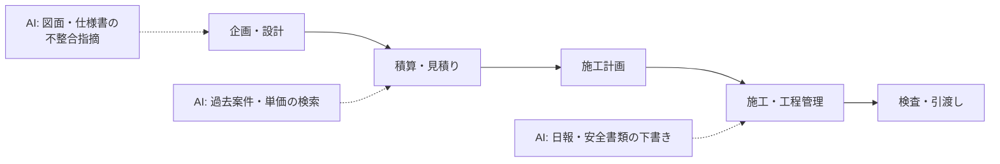

建設・建築は、図面・仕様書・施工計画書・日報など**文書と図面の量が非常に多い**一方で、構造安全・法適合・現場の安全の責任は資格者が負う領域です。AI は**照合・転記・下書き**で人手不足を補い、判断は建築士・現場代理人に残す設計が前提になります。

## 業務の全体像

- 企画・設計（意匠・構造・設備）と法規チェック
- 積算・見積り・入札
- 施工計画・工程管理・安全管理
- 検査・引渡し・維持管理

## AI が効きそうな場面

| 業務 | AI の関わり方 | 人間に残る役割 |
|---|---|---|
| 図面・仕様書の照合 | 図面間・仕様書との不整合や記載漏れの指摘 | 設計判断・法適合の確認 |
| 施工管理の文書 | 日報・施工計画書・安全書類の下書き、写真の整理 | 内容の確認・安全上の判断 |
| 見積り | 過去案件・単価表の検索と数量拾いの補助 | 価格決定・リスクの見込み |

## この領域特有の制約

- 国土交通省は i-Construction 2.0 で建設現場のオートメーション化を掲げ、直轄土木では BIM/CIM の適用を進めている。建築では BIM 図面審査など確認申請での BIM 活用も始まっている（下の一次情報を参照）。AI は BIM/CIM のデータを正本として使う設計にする
- 設計・工事監理は建築士の業務。AI の指摘はあくまで候補で、確定は資格者が行う
- 現場の安全に関わる手順は、AI の下書きでも必ず現場で検証してから承認する
- 図面・入札前の積算情報は機密性が高い。外部サービスへの入力範囲を事前に決める

## ユースケース

- [図面・仕様書の整合チェック](./use-cases/drawing-check.md)
- [施工日報・施工計画書の下書き](./use-cases/site-report.md)

## AI 導入マップ（業務フロー × AI の掛かる場所）

<!-- generated:phase-playbook -->
## 法令・ガイドライン（着手前に一次情報で確認）

保存期間・届出などの具体的な要件は改正されるため、このサイトでは数値を転記せず、一次情報へのリンクのみを載せています。案件ごとに原文と顧客の社内規程で確認してください。

| 法令・ガイドライン | 関係する論点 |
|---|---|
| [国土交通省 i-Construction（i-Construction 2.0）](https://www.mlit.go.jp/tec/i-construction/) | 建設現場のオートメーション化・省人化の方針 |
| [国土交通省 BIM/CIM 関連（基準・要領）](https://www.mlit.go.jp/tec/tec_tk_000037.html) | 直轄土木での BIM/CIM 適用方針・取扱要領 |
| [国土交通省 建築 BIM 推進会議](https://www.mlit.go.jp/jutakukentiku/kenchikuBIMsuishinkaigi.html) | 建築 BIM の標準ワークフロー・BIM 図面審査 |
| [建設業法](https://laws.e-gov.go.jp/law/324AC0000000100) | 請負契約・施工体制・技術者配置 |
| [建築基準法](https://laws.e-gov.go.jp/law/325AC0000000201) | 建築確認・構造・用途の基準 |
| [建築士法](https://laws.e-gov.go.jp/law/325AC1000000202) | 設計・工事監理の業務独占と責任 |
| [労働安全衛生法](https://laws.e-gov.go.jp/law/347AC0000000057) | 現場の安全衛生管理 |

## 判断表: どこまで AI に任せるか

| 業務の種類 | 推奨する自動化の度合い | 確定する人 |
|---|---|---|
| 検索・要約・分類（社内向け） | AI が実行し、事後に抜き取り確認 | 建築士・現場代理人（監理技術者） |
| 下書き（社外・利用者向け） | AI が下書きし、人が確認して確定 | 建築士・現場代理人（監理技術者） |
| 構造・法適合の判断、設計図書の確定、安全に関わる施工方法の承認 | AI は根拠の提示・論点整理まで | 建築士・現場代理人（監理技術者） |

## 成果指標の例

図面チェック 1 件あたりの時間、施工計画書・日報の作成時間、見積り回答までの日数。測り方とベースラインの取り方は[要件化と成果指標](/guide/requirements-and-kpi)を参照。

## 評価セットに必ず入れるケース

法規・条例が重なる敷地、設計変更が繰り返された図面、安全に関わる仮設計画。評価の作り方は[評価](/guide/evaluation)を参照。

## 工程別の要点（建設・建築 × 工程）

| 工程 | 方式 | 主な成果物 |
|---|---|---|
| [要件定義](/matrix/construction/waterfall/requirements) | ウォーターフォール | 成果指標合意書（業務指標・品質指標・ガードレール・判断者） |
| [設計](/matrix/construction/waterfall/design) | ウォーターフォール | 設計 1 枚紙（分担・パターン・入口・データ・人の確認・ログ・停止条件） |
| [実装](/matrix/construction/waterfall/implementation) | ウォーターフォール | 動くプロトタイプ・プロンプト資産・反復レポート |
| [テスト](/matrix/construction/waterfall/testing) | ウォーターフォール | 評価レポート（評価セットの版・指標・悪化ケース・判断） |
| [リリース](/matrix/construction/waterfall/deployment) | ウォーターフォール | 本番化判断資料（品質・業務効果・統制・コスト・展開計画） |
| [運用・改善](/matrix/construction/waterfall/maintenance) | ウォーターフォール | 運用移管書・週次レビュー記録 |
| [スプリントプランニング](/matrix/construction/agile/sprint-planning) | アジャイル | スプリントゴールと試用計画 |
| [バックログリファインメント](/matrix/construction/agile/backlog-refinement) | アジャイル | 優先度付きバックログ |
| [デイリースクラム](/matrix/construction/agile/daily-scrum) | アジャイル | 日次メモ |
| [レビュー](/matrix/construction/agile/review) | アジャイル | 反復レポート・合意事項 |
| [レトロスペクティブ](/matrix/construction/agile/retrospective) | アジャイル | 改善アクション（次スプリントで実施） |

## よくある落とし穴

- **構造・法適合の判断、設計図書の確定、安全に関わる施工方法の承認まで AI に任せる設計にする**: 責任の所在が曖昧になり、統制部門の承認が下りない
- **BIM/CIM モデル・図面管理・工事情報共有システム（ASP）と別の画面を作る**: 二重入力になり、現場が使わなくなる
- **施主情報・図面・入札前の積算情報を分類せずに入力する**: 着手後に作り直しになる
- **変化（法令・基準類の改正、設計変更、協力会社の入れ替わり）を監視しない**: 静かに品質が劣化する

## チェックリスト

- [ ] 上の法令・ガイドラインを一次情報で確認した
- [ ] 人に残す判断を業務オーナーと合意した
- [ ] BIM/CIM モデル・図面管理・工事情報共有システム（ASP）との連携方法を情シスと確認した
- [ ] 評価セットに難しいケースを含めた

## 参考: 中国の事例（Datawhale『FDE案例100』）

以下は**中国の事例**を本サイトが要約したものです。日本の建築基準・資格制度とは異なるため、業務の分け方と人の役割の置き方を参考にしてください（[事例集の紹介ページ](/references/datawhale-fde100)）。

- **第一册 NO.21**: 建築設計の図面作成で、作図と規範チェックの多くを AI が下支えし、設計者は専門判断に時間を回す構成。大型案件でも初期案を短時間で出せるようにした（出典: Datawhale『FDE案例100』第一册 NO.21、[PDF](https://assets.datawhale.cn/Datawhale%20FDE%E6%A1%88%E4%BE%8B100.pdf) / [fde100.datawhale.cn](https://fde100.datawhale.cn)）
- **第一册 NO.23**: 建機レンタル会社で、経営者に頼っていた見積りと小口の問い合わせ対応を仕組み化。納品後に効果を追跡しなかったことを反省点として挙げている（出典: Datawhale『FDE案例100』第一册 NO.23、[PDF](https://assets.datawhale.cn/Datawhale%20FDE%E6%A1%88%E4%BE%8B100.pdf) / [fde100.datawhale.cn](https://fde100.datawhale.cn)）
- **第一册 NO.13**: 消防設備の保守会社で、紙の点検記録をデジタル化し、データに基づく業務へ移行（出典: Datawhale『FDE案例100』第一册 NO.13、[PDF](https://assets.datawhale.cn/Datawhale%20FDE%E6%A1%88%E4%BE%8B100.pdf) / [fde100.datawhale.cn](https://fde100.datawhale.cn)）
- **浙江省編 09**: 工事案件が中心の製造企業で、入札書類・契約・検収書類の作成やシステム間のデータ集計を AI で効率化。新しいシステムを入れるのではなく、既存の OA・ERP の間の手作業を減らした（出典: Datawhale『FDE案例100』浙江省編 09、[PDF](https://oss.linklearner.com/SEO/Datawhale%20FDE100%E6%A1%88%E4%BE%8B%E9%9B%86%E6%B5%99%E6%B1%9F%E7%AF%87.pdf) / [fde100.datawhale.cn](https://fde100.datawhale.cn)）
