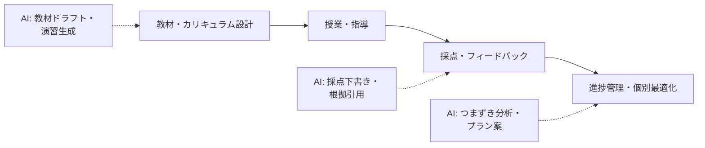

教育領域では、AI を「教師の代替」ではなく「教師と学習者の間に入る支援者」として設計するのが本リポジトリの方針です。

## 業務の全体像

- 教材・カリキュラム設計
- 授業・指導の実施
- 採点・フィードバック
- 学習者の進捗管理と個別最適化
- 保護者・管理者への報告

## AI が効きそうな場面

| 業務 | AI の関わり方 | 人間に残る役割 |
|---|---|---|
| 採点・フィードバック | 採点下書き・個別フィードバック文の生成 | 最終判定、特に合否に関わる採点 |
| 教材作成 | レベル別の説明・例題の生成 | 教育目標との整合確認 |
| 個別最適化 | つまずきパターンの分析と対策案 | 学習者との対話と動機づけ |

## この領域特有の制約

- 学習データは個人情報・要配慮情報になりうる
- 「AI に書かせた宿題」など、学習者側の AI 利用ルールも設計対象
- 誤った説明がそのまま信じられるリスク（ハルシネーション対策は必須）

## ユースケース

- [採点支援ツール（教育）](./use-cases/grading-assistant.md)
- [個別学習プラン生成ツール](./use-cases/individual-learning-plan.md)
- [教材ドラフト生成ツール](./use-cases/lesson-material-draft.md)

## AI 導入マップ（業務フロー × AI の掛かる場所）

<!-- generated:phase-playbook -->
## 法令・ガイドライン（着手前に一次情報で確認）

保存期間・届出などの具体的な要件は改正されるため、このサイトでは数値を転記せず、一次情報へのリンクのみを載せています。案件ごとに原文と顧客の社内規程で確認してください。

| 法令・ガイドライン | 関係する論点 |
|---|---|
| [文部科学省 生成 AI の利活用に関するガイドライン](https://www.mext.go.jp/a_menu/other/mext_02412.html) | 学校現場での生成 AI 利用の考え方 |
| [学校教育法施行規則](https://laws.e-gov.go.jp/law/322M40000080011) | 指導要録などの作成・保存 |
| [個人情報保護委員会「生成 AI サービスの利用に関する注意喚起」](https://www.ppc.go.jp/news/careful_information/230602_AI_utilize_alert/) | 個人データを入力する場合の利用目的・学習利用の確認 |
| [著作権法](https://laws.e-gov.go.jp/law/345AC0000000048) | 生成物・学習データ・引用の扱い |

## 判断表: どこまで AI に任せるか

| 業務の種類 | 推奨する自動化の度合い | 確定する人 |
|---|---|---|
| 検索・要約・分類（社内向け） | AI が実行し、事後に抜き取り確認 | 担当教員 |
| 下書き（社外・利用者向け） | AI が下書きし、人が確認して確定 | 担当教員 |
| 成績・評定の確定、児童生徒への個別の指導判断 | AI は根拠の提示・論点整理まで | 担当教員 |

## 成果指標の例

教材・評価の下書き作成時間、採点 1 件あたりの時間、講評の返却までの日数。測り方とベースラインの取り方は[要件化と成果指標](/guide/requirements-and-kpi)を参照。

## 評価セットに必ず入れるケース

記述の解釈が分かれる答案、配慮が必要な児童生徒に関する記述、学習指導要領の範囲外の内容。評価の作り方は[評価](/guide/evaluation)を参照。

## 工程別の要点（教育 × 工程）

| 工程 | 方式 | 主な成果物 |
|---|---|---|
| [要件定義](/matrix/education/waterfall/requirements) | ウォーターフォール | 成果指標合意書（業務指標・品質指標・ガードレール・判断者） |
| [設計](/matrix/education/waterfall/design) | ウォーターフォール | 設計 1 枚紙（分担・パターン・入口・データ・人の確認・ログ・停止条件） |
| [実装](/matrix/education/waterfall/implementation) | ウォーターフォール | 動くプロトタイプ・プロンプト資産・反復レポート |
| [テスト](/matrix/education/waterfall/testing) | ウォーターフォール | 評価レポート（評価セットの版・指標・悪化ケース・判断） |
| [リリース](/matrix/education/waterfall/deployment) | ウォーターフォール | 本番化判断資料（品質・業務効果・統制・コスト・展開計画） |
| [運用・改善](/matrix/education/waterfall/maintenance) | ウォーターフォール | 運用移管書・週次レビュー記録 |
| [スプリントプランニング](/matrix/education/agile/sprint-planning) | アジャイル | スプリントゴールと試用計画 |
| [バックログリファインメント](/matrix/education/agile/backlog-refinement) | アジャイル | 優先度付きバックログ |
| [デイリースクラム](/matrix/education/agile/daily-scrum) | アジャイル | 日次メモ |
| [レビュー](/matrix/education/agile/review) | アジャイル | 反復レポート・合意事項 |
| [レトロスペクティブ](/matrix/education/agile/retrospective) | アジャイル | 改善アクション（次スプリントで実施） |

## よくある落とし穴

- **成績・評定の確定、児童生徒への個別の指導判断まで AI に任せる設計にする**: 責任の所在が曖昧になり、統制部門の承認が下りない
- **校務支援システム・学習管理システムと別の画面を作る**: 二重入力になり、現場が使わなくなる
- **児童生徒の氏名・成績・配慮事項を分類せずに入力する**: 着手後に作り直しになる
- **変化（学習指導要領・教科書の改訂、学校ごとの評価基準）を監視しない**: 静かに品質が劣化する

## チェックリスト

- [ ] 上の法令・ガイドラインを一次情報で確認した
- [ ] 人に残す判断を業務オーナーと合意した
- [ ] 校務支援システム・学習管理システムとの連携方法を情シスと確認した
- [ ] 評価セットに難しいケースを含めた

