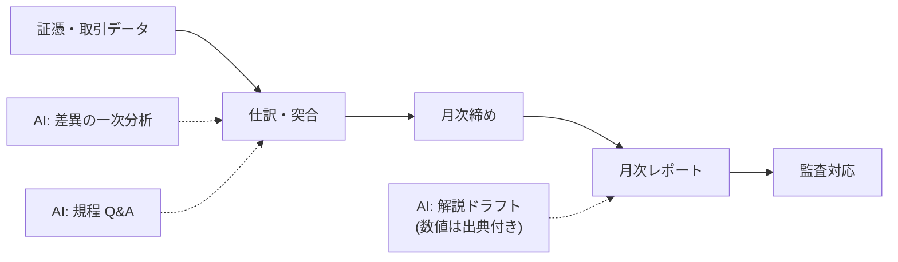

金融・経理は**数値の正確性と監査可能性**がすべての領域です。AI の強み（文章化・整理）と弱み（数値の生成）を明確に分離するのが設計の核心です。

## 業務の全体像

- 月次・四半期レポートの作成
- データ突合・確認（請求、支払、残高）
- 規程・税制の調査と社内Q&A
- 監査対応資料の整備

## AI が効きそうな場面

| 業務 | AI の関わり方 | 人間に残る役割 |
|---|---|---|
| レポート作成 | 数値の解説文・要約のドラフト | 数値の出典確認・経営判断 |
| 突合確認 | 差異の抽出とパターン分類 | 差異の原因分析・処理判断 |
| 規程Q&A | 規程検索（RAG）と引用付き回答 | 解釈の最終判断 |

## この領域特有の制約

- **AI に数値を計算・生成させない**。数値は必ずシステム・表計算から渡し、AI は解説するだけ
- 記録は監査対象。「AI が書いた」ことと「誰が確認したか」を記録に残す
- 市場・税制の情報は鮮度が命。出典の日付確認を必須化

## ユースケース

- [月次レポートのドラフトと数値突合](./use-cases/monthly-report.md)
- [社内規程・制度のQ- [月次レポートのドラフトと数値突合](./use-cases/monthly-report.md)A応答](./use-cases/policy-qa.md)

## AI 導入マップ（業務フロー × AI の掛かる場所）

<!-- generated:phase-playbook -->
## 法令・ガイドライン（着手前に一次情報で確認）

保存期間・届出などの具体的な要件は改正されるため、このサイトでは数値を転記せず、一次情報へのリンクのみを載せています。案件ごとに原文と顧客の社内規程で確認してください。

| 法令・ガイドライン | 関係する論点 |
|---|---|
| [電子帳簿保存法](https://laws.e-gov.go.jp/law/410AC0000000025) | 電子取引データ・帳簿の保存要件 |
| [個人情報保護委員会「生成 AI サービスの利用に関する注意喚起」](https://www.ppc.go.jp/news/careful_information/230602_AI_utilize_alert/) | 個人データを入力する場合の利用目的・学習利用の確認 |
| [金融庁（所管業種の場合は監督指針・ガイドラインを確認）](https://www.fsa.go.jp/) | 金融機関の外部委託・システムリスク管理 |

## 判断表: どこまで AI に任せるか

| 業務の種類 | 推奨する自動化の度合い | 確定する人 |
|---|---|---|
| 検索・要約・分類（社内向け） | AI が実行し、事後に抜き取り確認 | 経理担当者と承認者（職務分離） |
| 下書き（社外・利用者向け） | AI が下書きし、人が確認して確定 | 経理担当者と承認者（職務分離） |
| 仕訳の確定、開示数値の確定、内部統制上のキー統制 | AI は根拠の提示・論点整理まで | 経理担当者と承認者（職務分離） |

## 成果指標の例

月次締めの日数、照合・突合 1 件あたりの時間、差異の見落とし件数。測り方とベースラインの取り方は[要件化と成果指標](/guide/requirements-and-kpi)を参照。

## 評価セットに必ず入れるケース

端数・為替・按分を含む取引、科目判断が分かれる取引、前期からの修正仕訳。評価の作り方は[評価](/guide/evaluation)を参照。

## 工程別の要点（金融・経理 × 工程）

| 工程 | 方式 | 主な成果物 |
|---|---|---|
| [要件定義](/matrix/finance/waterfall/requirements) | ウォーターフォール | 成果指標合意書（業務指標・品質指標・ガードレール・判断者） |
| [設計](/matrix/finance/waterfall/design) | ウォーターフォール | 設計 1 枚紙（分担・パターン・入口・データ・人の確認・ログ・停止条件） |
| [実装](/matrix/finance/waterfall/implementation) | ウォーターフォール | 動くプロトタイプ・プロンプト資産・反復レポート |
| [テスト](/matrix/finance/waterfall/testing) | ウォーターフォール | 評価レポート（評価セットの版・指標・悪化ケース・判断） |
| [リリース](/matrix/finance/waterfall/deployment) | ウォーターフォール | 本番化判断資料（品質・業務効果・統制・コスト・展開計画） |
| [運用・改善](/matrix/finance/waterfall/maintenance) | ウォーターフォール | 運用移管書・週次レビュー記録 |
| [スプリントプランニング](/matrix/finance/agile/sprint-planning) | アジャイル | スプリントゴールと試用計画 |
| [バックログリファインメント](/matrix/finance/agile/backlog-refinement) | アジャイル | 優先度付きバックログ |
| [デイリースクラム](/matrix/finance/agile/daily-scrum) | アジャイル | 日次メモ |
| [レビュー](/matrix/finance/agile/review) | アジャイル | 反復レポート・合意事項 |
| [レトロスペクティブ](/matrix/finance/agile/retrospective) | アジャイル | 改善アクション（次スプリントで実施） |

## よくある落とし穴

- **仕訳の確定、開示数値の確定、内部統制上のキー統制まで AI に任せる設計にする**: 責任の所在が曖昧になり、統制部門の承認が下りない
- **会計システム・ERPと別の画面を作る**: 二重入力になり、現場が使わなくなる
- **取引先名・口座番号・未公表の財務情報を分類せずに入力する**: 着手後に作り直しになる
- **変化（会計基準・税制の改正、勘定科目体系の変更）を監視しない**: 静かに品質が劣化する

## チェックリスト

- [ ] 上の法令・ガイドラインを一次情報で確認した
- [ ] 人に残す判断を業務オーナーと合意した
- [ ] 会計システム・ERPとの連携方法を情シスと確認した
- [ ] 評価セットに難しいケースを含めた

