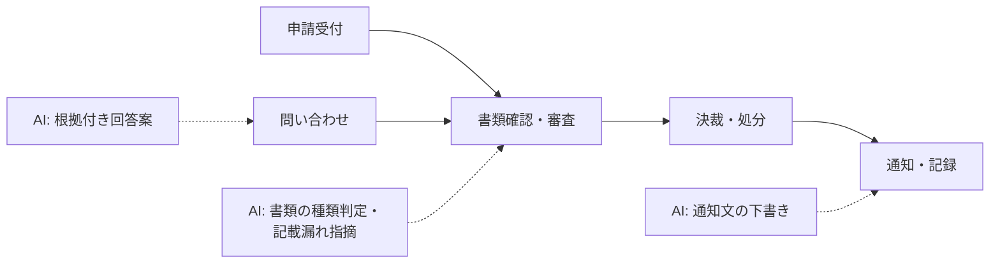

行政・公共の業務は「**公平性・説明責任・記録**」が前提です。AI は申請書類の確認や問い合わせの一次対応、文書の下書きで職員の負担を減らせますが、**処分・許認可・給付の可否は必ず職員が決め、その理由を説明できる状態**を保つ設計が欠かせません。

## 業務の全体像

- 申請・届出の受付と審査（電子申請を含む）
- 住民・事業者からの問い合わせ対応
- 議会答弁・通知文・広報などの文書作成
- 計画策定・統計の整理と庁内調整

## AI が効きそうな場面

| 業務 | AI の関わり方 | 人間に残る役割 |
|---|---|---|
| 申請審査 | 添付書類の種類判定・記載漏れの指摘・基幹システムへの転記案 | 要件の充足判断・処分の決定 |
| 問い合わせ | 制度 FAQ の検索と回答案（根拠条文・要綱の提示付き） | 個別事情の判断・最終回答 |
| 文書作成 | 通知文・答弁の下書き、過去文書との整合確認 | 内容の確定・決裁 |

## この領域特有の制約

- 政府機関では、デジタル庁の生成 AI ガイドライン（下の一次情報）に沿ったリスク判定と調達・契約時の確認が求められる。自治体も多くがこれを参考に独自ルールを定めている
- 行政文書は作成・保存のルールが法令・規程で定められている。AI の入出力ログが行政文書に当たるかを文書管理担当と確認する
- 住民の個人情報（マイナンバーを含む）は、入力可否を情報政策部門と事前に決める
- 判断の根拠が説明できない出力は使えない。根拠（条文・要綱・過去事例）を必ず添えて表示する

## ユースケース

- [電子申請の添付書類チェック](./use-cases/application-screening.md)
- [住民問い合わせの回答案作成](./use-cases/inquiry-response.md)

## AI 導入マップ（業務フロー × AI の掛かる場所）

<!-- generated:phase-playbook -->
## 法令・ガイドライン（着手前に一次情報で確認）

保存期間・届出などの具体的な要件は改正されるため、このサイトでは数値を転記せず、一次情報へのリンクのみを載せています。案件ごとに原文と顧客の社内規程で確認してください。

| 法令・ガイドライン | 関係する論点 |
|---|---|
| [デジタル庁「行政の進化と革新のための生成 AI の調達・利活用に係るガイドライン（第 2.0 版）」](https://www.digital.go.jp/news/decb64eb-f26e-41cb-8d37-f3dd173108b8) | 政府の生成 AI のガバナンス・調達・利活用ルール（2026-09-01 施行） |
| [情報通信技術を活用した行政の推進等に関する法律（デジタル手続法）](https://laws.e-gov.go.jp/law/414AC0000000151) | 行政手続のオンライン化の原則 |
| [公文書等の管理に関する法律](https://laws.e-gov.go.jp/law/421AC0000000066) | 行政文書の作成・保存・管理 |
| [個人情報の保護に関する法律](https://laws.e-gov.go.jp/law/415AC0000000057) | 行政機関等の保有個人情報の取扱い（第 5 章） |
| [総務省 自治体 DX 推進](https://www.soumu.go.jp/denshijiti/index_00001.html) | 自治体 DX 推進計画・AI 活用の手引き |

## 判断表: どこまで AI に任せるか

| 業務の種類 | 推奨する自動化の度合い | 確定する人 |
|---|---|---|
| 検索・要約・分類（社内向け） | AI が実行し、事後に抜き取り確認 | 担当職員と決裁権者 |
| 下書き（社外・利用者向け） | AI が下書きし、人が確認して確定 | 担当職員と決裁権者 |
| 許認可・給付の可否の決定、住民への処分の通知 | AI は根拠の提示・論点整理まで | 担当職員と決裁権者 |

## 成果指標の例

申請 1 件あたりの審査時間、窓口・電話の問い合わせ件数、申請から処理完了までの日数。測り方とベースラインの取り方は[要件化と成果指標](/guide/requirements-and-kpi)を参照。

## 評価セットに必ず入れるケース

添付書類の不足・不鮮明な画像、例外規定が適用される申請、制度改正の前後にまたがる申請。評価の作り方は[評価](/guide/evaluation)を参照。

## 工程別の要点（行政・公共 × 工程）

| 工程 | 方式 | 主な成果物 |
|---|---|---|
| [要件定義](/matrix/government/waterfall/requirements) | ウォーターフォール | 成果指標合意書（業務指標・品質指標・ガードレール・判断者） |
| [設計](/matrix/government/waterfall/design) | ウォーターフォール | 設計 1 枚紙（分担・パターン・入口・データ・人の確認・ログ・停止条件） |
| [実装](/matrix/government/waterfall/implementation) | ウォーターフォール | 動くプロトタイプ・プロンプト資産・反復レポート |
| [テスト](/matrix/government/waterfall/testing) | ウォーターフォール | 評価レポート（評価セットの版・指標・悪化ケース・判断） |
| [リリース](/matrix/government/waterfall/deployment) | ウォーターフォール | 本番化判断資料（品質・業務効果・統制・コスト・展開計画） |
| [運用・改善](/matrix/government/waterfall/maintenance) | ウォーターフォール | 運用移管書・週次レビュー記録 |
| [スプリントプランニング](/matrix/government/agile/sprint-planning) | アジャイル | スプリントゴールと試用計画 |
| [バックログリファインメント](/matrix/government/agile/backlog-refinement) | アジャイル | 優先度付きバックログ |
| [デイリースクラム](/matrix/government/agile/daily-scrum) | アジャイル | 日次メモ |
| [レビュー](/matrix/government/agile/review) | アジャイル | 反復レポート・合意事項 |
| [レトロスペクティブ](/matrix/government/agile/retrospective) | アジャイル | 改善アクション（次スプリントで実施） |

## よくある落とし穴

- **許認可・給付の可否の決定、住民への処分の通知まで AI に任せる設計にする**: 責任の所在が曖昧になり、統制部門の承認が下りない
- **基幹業務システム・電子申請システム・文書管理システムと別の画面を作る**: 二重入力になり、現場が使わなくなる
- **住民の個人情報（マイナンバー・住所・所得など）を分類せずに入力する**: 着手後に作り直しになる
- **変化（法令・条例・要綱の改正、様式の変更）を監視しない**: 静かに品質が劣化する

## チェックリスト

- [ ] 上の法令・ガイドラインを一次情報で確認した
- [ ] 人に残す判断を業務オーナーと合意した
- [ ] 基幹業務システム・電子申請システム・文書管理システムとの連携方法を情シスと確認した
- [ ] 評価セットに難しいケースを含めた

## 参考: 中国の事例（Datawhale『FDE案例100』）

以下は**中国の事例**を本サイトが要約したものです。日本の行政手続きとは制度が異なるため、課題の分け方と定着の工夫を参考にしてください（[事例集の紹介ページ](/references/datawhale-fde100)）。

- **第一册 NO.2 / 浙江省編 01**: 車両登録窓口のオンライン申請で、添付画像の種類判定・情報の読み取り・審査・システム間の転記を一続きの流れとして自動化。保守案件で現場に入り、職員が当たり前と思っていた手作業から課題を見つけた点が要点（出典: Datawhale『FDE案例100』第一册 NO.2・浙江省編 01、[第一册 PDF](https://assets.datawhale.cn/Datawhale%20FDE%E6%A1%88%E4%BE%8B100.pdf) / [浙江省編 PDF](https://oss.linklearner.com/SEO/Datawhale%20FDE100%E6%A1%88%E4%BE%8B%E9%9B%86%E6%B5%99%E6%B1%9F%E7%AF%87.pdf) / [fde100.datawhale.cn](https://fde100.datawhale.cn)）
- **第一册 NO.4 / 浙江省編 03**: 都市計画の検討で、部門ごとに分かれていた情報を集めて検討レポートの初稿を短時間で作る仕組み。出力を「そのまま使う」ではなく「検討のたたき台」と位置づけている（出典: Datawhale『FDE案例100』第一册 NO.4・浙江省編 03、[第一册 PDF](https://assets.datawhale.cn/Datawhale%20FDE%E6%A1%88%E4%BE%8B100.pdf) / [浙江省編 PDF](https://oss.linklearner.com/SEO/Datawhale%20FDE100%E6%A1%88%E4%BE%8B%E9%9B%86%E6%B5%99%E6%B1%9F%E7%AF%87.pdf) / [fde100.datawhale.cn](https://fde100.datawhale.cn)）
