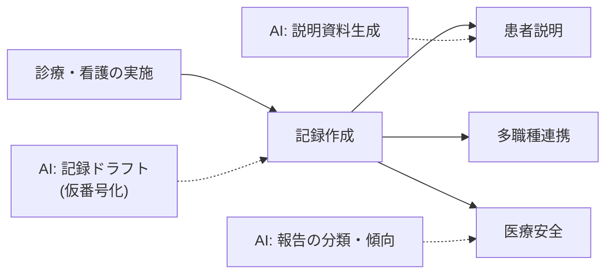

医療・看護は AI 協働の前提が最も厳しい領域です。このプロジェクトの方針は明確で、**診断・治療・投与など臨床判断は一切 AI に任せない**。AI が担うのは記録・説明・整理という「文書業務」です。

## 業務の全体像

- 診療・看護の実施（臨床判断 = **AI に任せない**）
- 診療記録・看護記録の作成
- 患者への説明・教育資料の準備
- 多職種連携（カンファレンス・引き継ぎ）
- 医療安全（インシデント報告・分析）

## AI が効きそうな場面

| 業務 | AI の関わり方 | 人間に残る役割 |
|---|---|---|
| 記録作成 | メモ・音声からの記録ドラフト生成 | 医学的正確性の確認・確定 |
| 患者説明 | 読みやすさに合わせた説明資料の作成 | 医学的内容の妥当性確認・実際の説明 |
| 報告整理 | インシデント報告の分類・傾向分析 | 分析・対策・再発防止の判断 |

## この領域特有の制約

- **個人情報の中でも特に要配慮**。外部 AI への入力は、利用規約・法制度・院内規程の三方確認が必須。ローカル / 専用契約環境の利用を前提に設計する
- 記録の誤りは診療ミスに直結しうる。AI ドラフトは**記録者本人が全文確認して確定**する
- 断定的な医学表現（「〜してください」）の生成は避け、説明資料は担当者が内容に責任を持つ

## ユースケース

- [看護記録の下書き支援](./use-cases/nursing-record.md)
- [患者説明資料の作成](./use-cases/patient-explainer.md)

## AI 導入マップ（業務フロー × AI の掛かる場所）

<!-- generated:phase-playbook -->
## 法令・ガイドライン（着手前に一次情報で確認）

保存期間・届出などの具体的な要件は改正されるため、このサイトでは数値を転記せず、一次情報へのリンクのみを載せています。案件ごとに原文と顧客の社内規程で確認してください。

| 法令・ガイドライン | 関係する論点 |
|---|---|
| [厚生労働省 医療情報システムの安全管理に関するガイドライン](https://www.mhlw.go.jp/stf/shingi/0000516275_00006.html) | 医療情報を扱うシステムの安全管理 |
| [医師法](https://laws.e-gov.go.jp/law/323AC0000000201) | 診療録の記載・保存 |
| [医療法](https://laws.e-gov.go.jp/law/323AC0000000205) | 医療に関する広告・記録 |
| [個人情報保護委員会「生成 AI サービスの利用に関する注意喚起」](https://www.ppc.go.jp/news/careful_information/230602_AI_utilize_alert/) | 個人データを入力する場合の利用目的・学習利用の確認 |

## 判断表: どこまで AI に任せるか

| 業務の種類 | 推奨する自動化の度合い | 確定する人 |
|---|---|---|
| 検索・要約・分類（社内向け） | AI が実行し、事後に抜き取り確認 | 記録を作成した医師・看護師 |
| 下書き（社外・利用者向け） | AI が下書きし、人が確認して確定 | 記録を作成した医師・看護師 |
| 診断・治療方針・投薬の判断 | AI は根拠の提示・論点整理まで | 記録を作成した医師・看護師 |

## 成果指標の例

記録作成時間、申し送りにかかる時間、患者説明資料の作成時間。測り方とベースラインの取り方は[要件化と成果指標](/guide/requirements-and-kpi)を参照。

## 評価セットに必ず入れるケース

略語・方言を含む記録、禁忌や投薬量が関わる記述、患者の状態が急変した記録。評価の作り方は[評価](/guide/evaluation)を参照。

## 工程別の要点（医療・看護 × 工程）

| 工程 | 方式 | 主な成果物 |
|---|---|---|
| [要件定義](/matrix/healthcare/waterfall/requirements) | ウォーターフォール | 成果指標合意書（業務指標・品質指標・ガードレール・判断者） |
| [設計](/matrix/healthcare/waterfall/design) | ウォーターフォール | 設計 1 枚紙（分担・パターン・入口・データ・人の確認・ログ・停止条件） |
| [実装](/matrix/healthcare/waterfall/implementation) | ウォーターフォール | 動くプロトタイプ・プロンプト資産・反復レポート |
| [テスト](/matrix/healthcare/waterfall/testing) | ウォーターフォール | 評価レポート（評価セットの版・指標・悪化ケース・判断） |
| [リリース](/matrix/healthcare/waterfall/deployment) | ウォーターフォール | 本番化判断資料（品質・業務効果・統制・コスト・展開計画） |
| [運用・改善](/matrix/healthcare/waterfall/maintenance) | ウォーターフォール | 運用移管書・週次レビュー記録 |
| [スプリントプランニング](/matrix/healthcare/agile/sprint-planning) | アジャイル | スプリントゴールと試用計画 |
| [バックログリファインメント](/matrix/healthcare/agile/backlog-refinement) | アジャイル | 優先度付きバックログ |
| [デイリースクラム](/matrix/healthcare/agile/daily-scrum) | アジャイル | 日次メモ |
| [レビュー](/matrix/healthcare/agile/review) | アジャイル | 反復レポート・合意事項 |
| [レトロスペクティブ](/matrix/healthcare/agile/retrospective) | アジャイル | 改善アクション（次スプリントで実施） |

## よくある落とし穴

- **診断・治療方針・投薬の判断まで AI に任せる設計にする**: 責任の所在が曖昧になり、統制部門の承認が下りない
- **電子カルテと別の画面を作る**: 二重入力になり、現場が使わなくなる
- **要配慮個人情報（病歴・診療情報）を分類せずに入力する**: 着手後に作り直しになる
- **変化（診療報酬・院内ルール・記録様式の改定）を監視しない**: 静かに品質が劣化する

## チェックリスト

- [ ] 上の法令・ガイドラインを一次情報で確認した
- [ ] 人に残す判断を業務オーナーと合意した
- [ ] 電子カルテとの連携方法を情シスと確認した
- [ ] 評価セットに難しいケースを含めた

