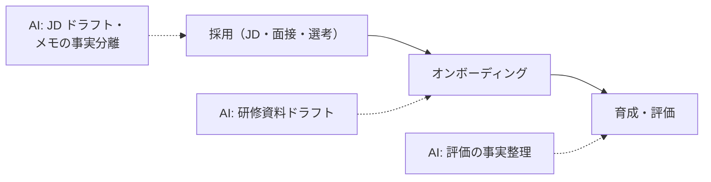

人事は「人を評価する」業務ゆえに、AI 利用には**公平性・差別防止**という特有のハードルがあります。AI は文章量を減らす道具であり、**評価・選考の判断そのものは人間が行う**のが本プロジェクトの前提です。

## 業務の全体像

- 採用（職務定義・応募者対応・選考・案内）
- 育成（研修設計・オンボーディング）
- 労務（手続き文書・規程の整備・相談対応の一次整理）
- 人事評価の運用設計

## AI が効きそうな場面

| 業務 | AI の関わり方 | 人間に残る役割 |
|---|---|---|
| 職務定義・JD | 媒体ごとの文案のドラフト | 求める人物像の確定 |
| 面接記録 | メモの事実抽出・整理 | 評価・合否判断 |
| 研修・オンボーディング | 資料・マニュアルのドラフト | 育成方針・評価 |

## この領域特有の制約

- **差別につながる属性への言及**（年齢・性別・国籍・健康管理 etc）を AI が生成しない設計にする。応募者選別の自動化は規制・倫理の両面で慎重に
- 面接メモ・評価は要配慮の個人情報。外部 AI に入れない運用が基本
- AI が作った「それらしい評価文」が選考の実質的判断になる構造を作らない

## ユースケース

- [面接メモの事実抽出](./use-cases/interview-notes.md)

## AI 導入マップ（業務フロー × AI の掛かる場所）

<!-- generated:phase-playbook -->
## 法令・ガイドライン（着手前に一次情報で確認）

保存期間・届出などの具体的な要件は改正されるため、このサイトでは数値を転記せず、一次情報へのリンクのみを載せています。案件ごとに原文と顧客の社内規程で確認してください。

| 法令・ガイドライン | 関係する論点 |
|---|---|
| [厚生労働省 公正な採用選考の基本](https://www.mhlw.go.jp/www2/topics/topics/saiyo/saiyo.htm) | 選考で収集してはならない情報・公正な選考 |
| [職業安定法](https://laws.e-gov.go.jp/law/322AC0000000141) | 求職者の個人情報の取扱い |
| [労働基準法](https://laws.e-gov.go.jp/law/322AC0000000049) | 労働条件・記録の保存 |
| [個人情報保護委員会「生成 AI サービスの利用に関する注意喚起」](https://www.ppc.go.jp/news/careful_information/230602_AI_utilize_alert/) | 個人データを入力する場合の利用目的・学習利用の確認 |

## 判断表: どこまで AI に任せるか

| 業務の種類 | 推奨する自動化の度合い | 確定する人 |
|---|---|---|
| 検索・要約・分類（社内向け） | AI が実行し、事後に抜き取り確認 | 面接官・人事担当者 |
| 下書き（社外・利用者向け） | AI が下書きし、人が確認して確定 | 面接官・人事担当者 |
| 採否・評価・処遇の決定 | AI は根拠の提示・論点整理まで | 面接官・人事担当者 |

## 成果指標の例

面接記録の作成時間、入社手続きの問い合わせ件数、オンボーディング資料の作成時間。測り方とベースラインの取り方は[要件化と成果指標](/guide/requirements-and-kpi)を参照。

## 評価セットに必ず入れるケース

職務に関係のない情報が含まれる面接メモ、評価が分かれる候補者、規程の例外が適用される社員。評価の作り方は[評価](/guide/evaluation)を参照。

## 工程別の要点（人事・採用 × 工程）

| 工程 | 方式 | 主な成果物 |
|---|---|---|
| [要件定義](/matrix/hr/waterfall/requirements) | ウォーターフォール | 成果指標合意書（業務指標・品質指標・ガードレール・判断者） |
| [設計](/matrix/hr/waterfall/design) | ウォーターフォール | 設計 1 枚紙（分担・パターン・入口・データ・人の確認・ログ・停止条件） |
| [実装](/matrix/hr/waterfall/implementation) | ウォーターフォール | 動くプロトタイプ・プロンプト資産・反復レポート |
| [テスト](/matrix/hr/waterfall/testing) | ウォーターフォール | 評価レポート（評価セットの版・指標・悪化ケース・判断） |
| [リリース](/matrix/hr/waterfall/deployment) | ウォーターフォール | 本番化判断資料（品質・業務効果・統制・コスト・展開計画） |
| [運用・改善](/matrix/hr/waterfall/maintenance) | ウォーターフォール | 運用移管書・週次レビュー記録 |
| [スプリントプランニング](/matrix/hr/agile/sprint-planning) | アジャイル | スプリントゴールと試用計画 |
| [バックログリファインメント](/matrix/hr/agile/backlog-refinement) | アジャイル | 優先度付きバックログ |
| [デイリースクラム](/matrix/hr/agile/daily-scrum) | アジャイル | 日次メモ |
| [レビュー](/matrix/hr/agile/review) | アジャイル | 反復レポート・合意事項 |
| [レトロスペクティブ](/matrix/hr/agile/retrospective) | アジャイル | 改善アクション（次スプリントで実施） |

## よくある落とし穴

- **採否・評価・処遇の決定まで AI に任せる設計にする**: 責任の所在が曖昧になり、統制部門の承認が下りない
- **人事システム・採用管理システムと別の画面を作る**: 二重入力になり、現場が使わなくなる
- **応募者・社員の個人情報、評価情報を分類せずに入力する**: 着手後に作り直しになる
- **変化（就業規則・人事制度の改定、採用要件の変化）を監視しない**: 静かに品質が劣化する

## チェックリスト

- [ ] 上の法令・ガイドラインを一次情報で確認した
- [ ] 人に残す判断を業務オーナーと合意した
- [ ] 人事システム・採用管理システムとの連携方法を情シスと確認した
- [ ] 評価セットに難しいケースを含めた

