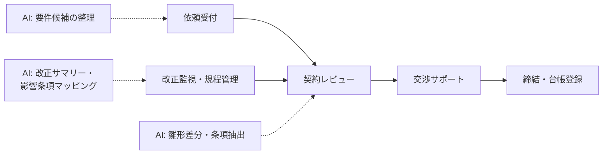

法務は「一字一句の正確さ」と「責任の所在」が問われる領域。AI は**一次整理と見落とし防止**に徹し、判断とアウトプットの責任は必ず人間（法務・弁護士）が持つ設計が不可欠です。

## 業務の全体像

- 契約書のレビュー・交渉サポート
- 社内規程・ドキュメントの整備
- 法改正・判例の調査
- コンプライアンス対応・相談対応

## AI が効きそうな場面

| 業務 | AI の関わり方 | 人間に残る役割 |
|---|---|---|
| 契約レビュー | リスク条項の抽出・雛形との差分整理 | リスク判断・修正案の確定・助言 |
| 調査 | 関連条文・判例の検索と要約（出典付き） | 情報の正確性検証・解釈 |
| 相談対応 | 一次の整理・FAQ 化 | 対応方針の決定 |

## この領域特有の制約

- **法的助言の責任は人間にある**。AI の出力を助言としてそのまま使わない
- ハルシネーション（実在しない条文・判例の引用）が致命傷 → 出典必須・必ず原文確認
- 守秘義務: 契約書・個人情報を外部 AI に入れる際は、利用規約と社内ルールの確認が必須

## ユースケース

- [契約レビューの一次整理](./use-cases/contract-review.md)
- [法改正・規程の調査整理](./use-cases/regulation-update.md)

## AI 導入マップ（業務フロー × AI の掛かる場所）

<!-- generated:phase-playbook -->
## 法令・ガイドライン（着手前に一次情報で確認）

保存期間・届出などの具体的な要件は改正されるため、このサイトでは数値を転記せず、一次情報へのリンクのみを載せています。案件ごとに原文と顧客の社内規程で確認してください。

| 法令・ガイドライン | 関係する論点 |
|---|---|
| [弁護士法](https://laws.e-gov.go.jp/law/324AC1000000205) | 第 72 条（非弁護士の法律事務の取扱い等の禁止） |
| [法務省 AI 等を用いた契約書等関連業務支援サービスと弁護士法第 72 条の関係について](https://www.moj.go.jp/content/001400675.pdf) | 契約レビュー支援サービスの考え方 |
| [個人情報保護委員会「生成 AI サービスの利用に関する注意喚起」](https://www.ppc.go.jp/news/careful_information/230602_AI_utilize_alert/) | 個人データを入力する場合の利用目的・学習利用の確認 |
| [著作権法](https://laws.e-gov.go.jp/law/345AC0000000048) | 生成物・学習データ・引用の扱い |

## 判断表: どこまで AI に任せるか

| 業務の種類 | 推奨する自動化の度合い | 確定する人 |
|---|---|---|
| 検索・要約・分類（社内向け） | AI が実行し、事後に抜き取り確認 | 法務担当者・弁護士 |
| 下書き（社外・利用者向け） | AI が下書きし、人が確認して確定 | 法務担当者・弁護士 |
| 法的判断・リスク評価の確定・相手方への回答 | AI は根拠の提示・論点整理まで | 法務担当者・弁護士 |

## 成果指標の例

契約レビュー 1 件あたりの時間、依頼から回答までの日数、論点の見落とし件数。測り方とベースラインの取り方は[要件化と成果指標](/guide/requirements-and-kpi)を参照。

## 評価セットに必ず入れるケース

雛形から大きく外れた条項、準拠法が外国法の契約、条文番号がずれた改訂版。評価の作り方は[評価](/guide/evaluation)を参照。

## 工程別の要点（法務 × 工程）

| 工程 | 方式 | 主な成果物 |
|---|---|---|
| [要件定義](/matrix/legal/waterfall/requirements) | ウォーターフォール | 成果指標合意書（業務指標・品質指標・ガードレール・判断者） |
| [設計](/matrix/legal/waterfall/design) | ウォーターフォール | 設計 1 枚紙（分担・パターン・入口・データ・人の確認・ログ・停止条件） |
| [実装](/matrix/legal/waterfall/implementation) | ウォーターフォール | 動くプロトタイプ・プロンプト資産・反復レポート |
| [テスト](/matrix/legal/waterfall/testing) | ウォーターフォール | 評価レポート（評価セットの版・指標・悪化ケース・判断） |
| [リリース](/matrix/legal/waterfall/deployment) | ウォーターフォール | 本番化判断資料（品質・業務効果・統制・コスト・展開計画） |
| [運用・改善](/matrix/legal/waterfall/maintenance) | ウォーターフォール | 運用移管書・週次レビュー記録 |
| [スプリントプランニング](/matrix/legal/agile/sprint-planning) | アジャイル | スプリントゴールと試用計画 |
| [バックログリファインメント](/matrix/legal/agile/backlog-refinement) | アジャイル | 優先度付きバックログ |
| [デイリースクラム](/matrix/legal/agile/daily-scrum) | アジャイル | 日次メモ |
| [レビュー](/matrix/legal/agile/review) | アジャイル | 反復レポート・合意事項 |
| [レトロスペクティブ](/matrix/legal/agile/retrospective) | アジャイル | 改善アクション（次スプリントで実施） |

## よくある落とし穴

- **法的判断・リスク評価の確定・相手方への回答まで AI に任せる設計にする**: 責任の所在が曖昧になり、統制部門の承認が下りない
- **契約管理システム（CLM）・文書管理と別の画面を作る**: 二重入力になり、現場が使わなくなる
- **取引条件・相手方情報・係争情報を分類せずに入力する**: 着手後に作り直しになる
- **変化（法改正・判例・自社雛形の改訂）を監視しない**: 静かに品質が劣化する

## チェックリスト

- [ ] 上の法令・ガイドラインを一次情報で確認した
- [ ] 人に残す判断を業務オーナーと合意した
- [ ] 契約管理システム（CLM）・文書管理との連携方法を情シスと確認した
- [ ] 評価セットに難しいケースを含めた

## 参考: 中国の事例（Datawhale『FDE案例100』）

以下は**中国の事例**を本サイトが要約したものです。詳細は原典を確認してください（[事例集の紹介ページ](/references/datawhale-fde100)）。

- **NO.3**: 訴訟チーム向けに、資料の読み込みから書面作成までを支援する作業環境を構築。大量資料の整理時間を大きく減らしたと報告（出典: Datawhale『FDE案例100』第一册 NO.3、[PDF](https://assets.datawhale.cn/Datawhale%20FDE%E6%A1%88%E4%BE%8B100.pdf) / [fde100.datawhale.cn](https://fde100.datawhale.cn)）
- **NO.19**: 消費財のパッケージ表示（栄養成分などの記載）を検証可能なルールとして審査（出典: Datawhale『FDE案例100』第一册 NO.19、[PDF](https://assets.datawhale.cn/Datawhale%20FDE%E6%A1%88%E4%BE%8B100.pdf) / [fde100.datawhale.cn](https://fde100.datawhale.cn)）
