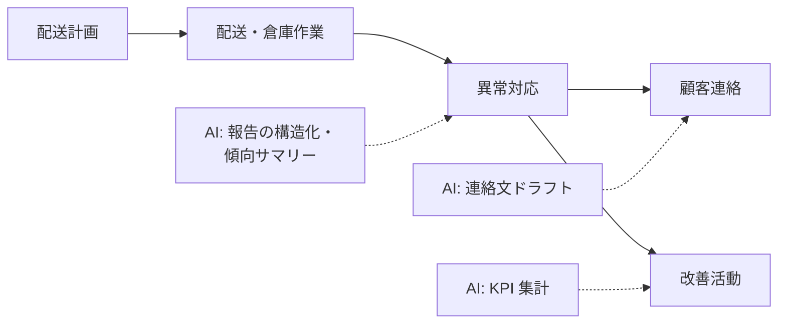

物流は現場（ドライバー・倉庫作業員）と管理の間で情報の粒度が最も落ちやすい領域です。AI は「現場の声 → 構造化データ → 管理の意思決定」の橋渡しに使うのが有効です。

## 業務の全体像

- 配送計画・運行管理
- 倉庫作業（入出庫・ピッキング・在庫）
- 異常対応（遅延・破損・欠品）と顧客連絡
- 改善活動（報告書・KPI 管理）

## AI が効きそうな場面

| 業務 | AI の関わり方 | 人間に残る役割 |
|---|---|---|
| 異常報告 | 自由記述の構造化・傾向整理 | 対応判断・顧客連絡 |
| 指示書 | 作業指示・注意喚起のドラフト | 安全確認・承認 |
| 改善 | 報告の集計・KPI サマリー | 改善施策の決定 |

## この領域特有の制約

- 時間単位で状況が変わる。AI に「現在の状況」を持たせず、常に最新データを渡す
- 安全に関わる指示（荷扱い・運転）の最終確認は人間
- 荷主情報・取引情報の取り扱い（共有範囲のルール化）

## ユースケース

- [配送異常報告の整理と傾向分析](./use-cases/delivery-anomaly.md)

## AI 導入マップ（業務フロー × AI の掛かる場所）

<!-- generated:phase-playbook -->
## 法令・ガイドライン（着手前に一次情報で確認）

保存期間・届出などの具体的な要件は改正されるため、このサイトでは数値を転記せず、一次情報へのリンクのみを載せています。案件ごとに原文と顧客の社内規程で確認してください。

| 法令・ガイドライン | 関係する論点 |
|---|---|
| [貨物自動車運送事業法](https://laws.e-gov.go.jp/law/401AC0000000083) | 運行管理・輸送の安全 |
| [中小受託取引適正化法（旧 下請法）](https://laws.e-gov.go.jp/law/331AC0000000120) | 運送委託・発注書面の扱い |
| [個人情報保護委員会「生成 AI サービスの利用に関する注意喚起」](https://www.ppc.go.jp/news/careful_information/230602_AI_utilize_alert/) | 個人データを入力する場合の利用目的・学習利用の確認 |

## 判断表: どこまで AI に任せるか

| 業務の種類 | 推奨する自動化の度合い | 確定する人 |
|---|---|---|
| 検索・要約・分類（社内向け） | AI が実行し、事後に抜き取り確認 | 運行管理者・センター管理者 |
| 下書き（社外・利用者向け） | AI が下書きし、人が確認して確定 | 運行管理者・センター管理者 |
| 運行可否・事故対応方針・補償の判断 | AI は根拠の提示・論点整理まで | 運行管理者・センター管理者 |

## 成果指標の例

異常報告の作成時間、荷主への連絡までの時間、問い合わせ一次回答率。測り方とベースラインの取り方は[要件化と成果指標](/guide/requirements-and-kpi)を参照。

## 評価セットに必ず入れるケース

複数の異常が重なった便、住所表記ゆれ、天候・事故による広域遅延。評価の作り方は[評価](/guide/evaluation)を参照。

## 工程別の要点（物流・サプライチェーン × 工程）

| 工程 | 方式 | 主な成果物 |
|---|---|---|
| [要件定義](/matrix/logistics/waterfall/requirements) | ウォーターフォール | 成果指標合意書（業務指標・品質指標・ガードレール・判断者） |
| [設計](/matrix/logistics/waterfall/design) | ウォーターフォール | 設計 1 枚紙（分担・パターン・入口・データ・人の確認・ログ・停止条件） |
| [実装](/matrix/logistics/waterfall/implementation) | ウォーターフォール | 動くプロトタイプ・プロンプト資産・反復レポート |
| [テスト](/matrix/logistics/waterfall/testing) | ウォーターフォール | 評価レポート（評価セットの版・指標・悪化ケース・判断） |
| [リリース](/matrix/logistics/waterfall/deployment) | ウォーターフォール | 本番化判断資料（品質・業務効果・統制・コスト・展開計画） |
| [運用・改善](/matrix/logistics/waterfall/maintenance) | ウォーターフォール | 運用移管書・週次レビュー記録 |
| [スプリントプランニング](/matrix/logistics/agile/sprint-planning) | アジャイル | スプリントゴールと試用計画 |
| [バックログリファインメント](/matrix/logistics/agile/backlog-refinement) | アジャイル | 優先度付きバックログ |
| [デイリースクラム](/matrix/logistics/agile/daily-scrum) | アジャイル | 日次メモ |
| [レビュー](/matrix/logistics/agile/review) | アジャイル | 反復レポート・合意事項 |
| [レトロスペクティブ](/matrix/logistics/agile/retrospective) | アジャイル | 改善アクション（次スプリントで実施） |

## よくある落とし穴

- **運行可否・事故対応方針・補償の判断まで AI に任せる設計にする**: 責任の所在が曖昧になり、統制部門の承認が下りない
- **配車システム・WMS・TMSと別の画面を作る**: 二重入力になり、現場が使わなくなる
- **届け先の氏名・住所・電話番号を分類せずに入力する**: 着手後に作り直しになる
- **変化（拠点・ルート・荷主ごとのルールの変更）を監視しない**: 静かに品質が劣化する

## チェックリスト

- [ ] 上の法令・ガイドラインを一次情報で確認した
- [ ] 人に残す判断を業務オーナーと合意した
- [ ] 配車システム・WMS・TMSとの連携方法を情シスと確認した
- [ ] 評価セットに難しいケースを含めた

## 参考: 中国の事例（Datawhale『FDE案例100』）

以下は**中国の事例**を本サイトが要約したものです。詳細は原典を確認してください（[事例集の紹介ページ](/references/datawhale-fde100)）。

- **NO.6**: 国境地域の越境物流で、トラックの積載計画を最適化。積載率が採算ラインに直結する業務で、作業員・物流会社・荷主の三者に利益が出る設計にした（出典: Datawhale『FDE案例100』第一册 NO.6、[PDF](https://assets.datawhale.cn/Datawhale%20FDE%E6%A1%88%E4%BE%8B100.pdf) / [fde100.datawhale.cn](https://fde100.datawhale.cn)）
- **NO.22**: 東南アジア向けアパレル EC で、在庫・補充・広告の判断をデータ連携。人は最終確認に回し、完全自動化は目指していない（出典: Datawhale『FDE案例100』第一册 NO.22、[PDF](https://assets.datawhale.cn/Datawhale%20FDE%E6%A1%88%E4%BE%8B100.pdf) / [fde100.datawhale.cn](https://fde100.datawhale.cn)）
