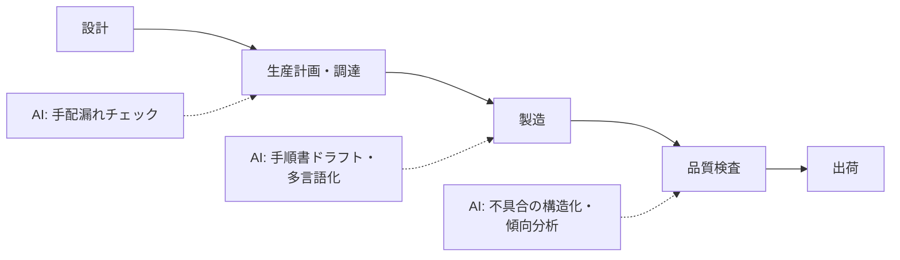

製造業では「文書業務」（手順書・報告書・仕様書）に AI を効かせる余地が大きい一方、**現場の安全と品質に関わる判断は一切 AI に任せない**のが前提です。

## 業務の全体像

- 設計・図面管理
- 作業手順書・作業標準の作成と改訂
- 品質管理（検査記録、不具合対応、8D レポート等）
- 設備保全・在庫・調達の文書業務

## AI が効きそうな場面

| 業務 | AI の関わり方 | 人間に残る役割 |
|---|---|---|
| 手順書作成 | ドラフト生成・構成の統一・図表の文言整理 | 安全性の確認・現場検証・承認 |
| 不具合報告 | 自由記述の分類・傾向の可視化・報告書下書き | 根因分析・対策決定 |
| 検査記録 | 記入漏れチェック・集計 | 判定・合格/不合格の判断 |

## この領域特有の制約

- 安全手順の誤りは**事故に直結**。AI 生成の手順書は必ず現場での検証を経て承認する
- ISO・業界規格の文書要件がある場合、規格への適合確認は人間の仕事
- 設計情報・顧客情報の取り扱い（どの情報を AI に入れてよいかのルール化が必須）

## ユースケース

- [作業手順書の作成・改訂支援](./use-cases/work-instruction.md)
- [不具合報告の整理と傾向分析](./use-cases/defect-report.md)

## AI 導入マップ（業務フロー × AI の掛かる場所）

<!-- generated:phase-playbook -->
## 法令・ガイドライン（着手前に一次情報で確認）

保存期間・届出などの具体的な要件は改正されるため、このサイトでは数値を転記せず、一次情報へのリンクのみを載せています。案件ごとに原文と顧客の社内規程で確認してください。

| 法令・ガイドライン | 関係する論点 |
|---|---|
| [製造物責任法](https://laws.e-gov.go.jp/law/406AC0000000085) | 製品の欠陥と記録の重要性 |
| [労働安全衛生法](https://laws.e-gov.go.jp/law/347AC0000000057) | 安全衛生教育・作業手順 |
| [著作権法](https://laws.e-gov.go.jp/law/345AC0000000048) | 生成物・学習データ・引用の扱い |

## 判断表: どこまで AI に任せるか

| 業務の種類 | 推奨する自動化の度合い | 確定する人 |
|---|---|---|
| 検索・要約・分類（社内向け） | AI が実行し、事後に抜き取り確認 | 品質保証担当・職長 |
| 下書き（社外・利用者向け） | AI が下書きし、人が確認して確定 | 品質保証担当・職長 |
| 出荷判定・安全手順の承認・設計変更の承認 | AI は根拠の提示・論点整理まで | 品質保証担当・職長 |

## 成果指標の例

不良報告書の作成時間、作業手順書の改訂リードタイム、是正処置の完了日数。測り方とベースラインの取り方は[要件化と成果指標](/guide/requirements-and-kpi)を参照。

## 評価セットに必ず入れるケース

複数要因が絡む不良、図面と現物の差異、安全に関わる手順の変更。評価の作り方は[評価](/guide/evaluation)を参照。

## 工程別の要点（製造 × 工程）

| 工程 | 方式 | 主な成果物 |
|---|---|---|
| [要件定義](/matrix/manufacturing/waterfall/requirements) | ウォーターフォール | 成果指標合意書（業務指標・品質指標・ガードレール・判断者） |
| [設計](/matrix/manufacturing/waterfall/design) | ウォーターフォール | 設計 1 枚紙（分担・パターン・入口・データ・人の確認・ログ・停止条件） |
| [実装](/matrix/manufacturing/waterfall/implementation) | ウォーターフォール | 動くプロトタイプ・プロンプト資産・反復レポート |
| [テスト](/matrix/manufacturing/waterfall/testing) | ウォーターフォール | 評価レポート（評価セットの版・指標・悪化ケース・判断） |
| [リリース](/matrix/manufacturing/waterfall/deployment) | ウォーターフォール | 本番化判断資料（品質・業務効果・統制・コスト・展開計画） |
| [運用・改善](/matrix/manufacturing/waterfall/maintenance) | ウォーターフォール | 運用移管書・週次レビュー記録 |
| [スプリントプランニング](/matrix/manufacturing/agile/sprint-planning) | アジャイル | スプリントゴールと試用計画 |
| [バックログリファインメント](/matrix/manufacturing/agile/backlog-refinement) | アジャイル | 優先度付きバックログ |
| [デイリースクラム](/matrix/manufacturing/agile/daily-scrum) | アジャイル | 日次メモ |
| [レビュー](/matrix/manufacturing/agile/review) | アジャイル | 反復レポート・合意事項 |
| [レトロスペクティブ](/matrix/manufacturing/agile/retrospective) | アジャイル | 改善アクション（次スプリントで実施） |

## よくある落とし穴

- **出荷判定・安全手順の承認・設計変更の承認まで AI に任せる設計にする**: 責任の所在が曖昧になり、統制部門の承認が下りない
- **MES・品質管理システム・文書管理（QMS）と別の画面を作る**: 二重入力になり、現場が使わなくなる
- **図面・製造ノウハウ・取引先情報を分類せずに入力する**: 着手後に作り直しになる
- **変化（4M 変更（人・機械・材料・方法）、製品仕様の改訂）を監視しない**: 静かに品質が劣化する

## チェックリスト

- [ ] 上の法令・ガイドラインを一次情報で確認した
- [ ] 人に残す判断を業務オーナーと合意した
- [ ] MES・品質管理システム・文書管理（QMS）との連携方法を情シスと確認した
- [ ] 評価セットに難しいケースを含めた

## 参考: 中国の事例（Datawhale『FDE案例100』）

以下は**中国の事例**を本サイトが要約したものです。詳細は原典を確認してください（[事例集の紹介ページ](/references/datawhale-fde100)）。

- **NO.1**: ドイツの部品メーカーで、ベテランの暗黙知を新人教育用の知識ベースに整理。最初に「新人をどう育てているか」を観察してから技術を選んだ点が要点（出典: Datawhale『FDE案例100』第一册 NO.1、[PDF](https://assets.datawhale.cn/Datawhale%20FDE%E6%A1%88%E4%BE%8B100.pdf) / [fde100.datawhale.cn](https://fde100.datawhale.cn)）
- **NO.8**: 海外の工業企業で、部材の特定を支援して重複購買を減らす。課題が事前に決まっていない状態から現場で見つけている（出典: Datawhale『FDE案例100』第一册 NO.8、[PDF](https://assets.datawhale.cn/Datawhale%20FDE%E6%A1%88%E4%BE%8B100.pdf) / [fde100.datawhale.cn](https://fde100.datawhale.cn)）
- **NO.17**: 受注生産の見積りで、熟練者の判断を AI が下支えする構成（出典: Datawhale『FDE案例100』第一册 NO.17、[PDF](https://assets.datawhale.cn/Datawhale%20FDE%E6%A1%88%E4%BE%8B100.pdf) / [fde100.datawhale.cn](https://fde100.datawhale.cn)）
- **NO.20**: 受注から経営指標までの流れを見える化（出典: Datawhale『FDE案例100』第一册 NO.20、[PDF](https://assets.datawhale.cn/Datawhale%20FDE%E6%A1%88%E4%BE%8B100.pdf) / [fde100.datawhale.cn](https://fde100.datawhale.cn)）
