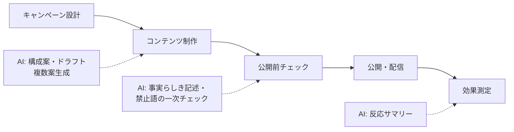

マーケティングは「量を作る」業務が多く AI と相性が良い一方、**ブランドの声・法的な表現**という人間にしかできない判断が混在する領域です。

## 業務の全体像

- コンテンツ制作（ブログ、SNS、メール、広告文）
- 顧客データの分析・レポート
- 市場・競合のリサーチ
- キャンペーン設計と効果測定

## AI が効きそうな場面

| 業務 | AI の関わり方 | 人間に残る役割 |
|---|---|---|
| コンテンツ制作 | 構成案・下書き・複数案の大量生成 | ブランドトーンの判定・事実確認・発信判断 |
| 分析 | データの傾向サマリー・グラフの解釈案 | 施策への解釈と意思決定 |
| リサーチ | 競合情報の整理・横断検索 | 情報の正確性検証・戦略への落とし込み |

## この領域特有の制約

- **景品表示法・薬機法など表現規制**：効能・最上級表現の確認は人間の必須作業
- AI 生成コンテンツの公開可否（利用サービスの規約・社内ポリシー）
- 誤情報の拡散リスク: 事実確認（ファクトチェック）を工程に必ず入れる

## ユースケース

- [コンテンツ制作支援](./use-cases/content-drafting.md)

## AI 導入マップ（業務フロー × AI の掛かる場所）

<!-- generated:phase-playbook -->
## 法令・ガイドライン（着手前に一次情報で確認）

保存期間・届出などの具体的な要件は改正されるため、このサイトでは数値を転記せず、一次情報へのリンクのみを載せています。案件ごとに原文と顧客の社内規程で確認してください。

| 法令・ガイドライン | 関係する論点 |
|---|---|
| [不当景品類及び不当表示防止法（景品表示法）](https://laws.e-gov.go.jp/law/337AC0000000134) | 優良誤認・有利誤認の禁止 |
| [消費者庁 ステルスマーケティング規制](https://www.caa.go.jp/policies/policy/representation/fair_labeling/stealth_marketing/) | 広告であることの明示 |
| [医薬品医療機器等法（該当商材の場合）](https://laws.e-gov.go.jp/law/335AC0000000145) | 効能効果の表現 |
| [著作権法](https://laws.e-gov.go.jp/law/345AC0000000048) | 生成物・学習データ・引用の扱い |

## 判断表: どこまで AI に任せるか

| 業務の種類 | 推奨する自動化の度合い | 確定する人 |
|---|---|---|
| 検索・要約・分類（社内向け） | AI が実行し、事後に抜き取り確認 | マーケティング責任者・法務 |
| 下書き（社外・利用者向け） | AI が下書きし、人が確認して確定 | マーケティング責任者・法務 |
| 公開判断・表現の法的判断 | AI は根拠の提示・論点整理まで | マーケティング責任者・法務 |

## 成果指標の例

コンテンツ制作のリードタイム、アンケート分類の時間、表現チェックの差し戻し件数。測り方とベースラインの取り方は[要件化と成果指標](/guide/requirements-and-kpi)を参照。

## 評価セットに必ず入れるケース

効能を示唆する表現、比較広告、皮肉や否定を含む自由回答。評価の作り方は[評価](/guide/evaluation)を参照。

## 工程別の要点（マーケティング × 工程）

| 工程 | 方式 | 主な成果物 |
|---|---|---|
| [要件定義](/matrix/marketing/waterfall/requirements) | ウォーターフォール | 成果指標合意書（業務指標・品質指標・ガードレール・判断者） |
| [設計](/matrix/marketing/waterfall/design) | ウォーターフォール | 設計 1 枚紙（分担・パターン・入口・データ・人の確認・ログ・停止条件） |
| [実装](/matrix/marketing/waterfall/implementation) | ウォーターフォール | 動くプロトタイプ・プロンプト資産・反復レポート |
| [テスト](/matrix/marketing/waterfall/testing) | ウォーターフォール | 評価レポート（評価セットの版・指標・悪化ケース・判断） |
| [リリース](/matrix/marketing/waterfall/deployment) | ウォーターフォール | 本番化判断資料（品質・業務効果・統制・コスト・展開計画） |
| [運用・改善](/matrix/marketing/waterfall/maintenance) | ウォーターフォール | 運用移管書・週次レビュー記録 |
| [スプリントプランニング](/matrix/marketing/agile/sprint-planning) | アジャイル | スプリントゴールと試用計画 |
| [バックログリファインメント](/matrix/marketing/agile/backlog-refinement) | アジャイル | 優先度付きバックログ |
| [デイリースクラム](/matrix/marketing/agile/daily-scrum) | アジャイル | 日次メモ |
| [レビュー](/matrix/marketing/agile/review) | アジャイル | 反復レポート・合意事項 |
| [レトロスペクティブ](/matrix/marketing/agile/retrospective) | アジャイル | 改善アクション（次スプリントで実施） |

## よくある落とし穴

- **公開判断・表現の法的判断まで AI に任せる設計にする**: 責任の所在が曖昧になり、統制部門の承認が下りない
- **CMS・MA・調査ツールと別の画面を作る**: 二重入力になり、現場が使わなくなる
- **顧客の個人情報・未発表の商品情報を分類せずに入力する**: 着手後に作り直しになる
- **変化（ブランドガイド・規制解釈・キャンペーン方針）を監視しない**: 静かに品質が劣化する

## チェックリスト

- [ ] 上の法令・ガイドラインを一次情報で確認した
- [ ] 人に残す判断を業務オーナーと合意した
- [ ] CMS・MA・調査ツールとの連携方法を情シスと確認した
- [ ] 評価セットに難しいケースを含めた

## 参考: 中国の事例（Datawhale『FDE案例100』）

以下は**中国の事例**を本サイトが要約したものです。詳細は原典を確認してください（[事例集の紹介ページ](/references/datawhale-fde100)）。

- **NO.5**: 越境 EC の TikTok クリエイター探索から進行管理までを効率化（出典: Datawhale『FDE案例100』第一册 NO.5、[PDF](https://assets.datawhale.cn/Datawhale%20FDE%E6%A1%88%E4%BE%8B100.pdf) / [fde100.datawhale.cn](https://fde100.datawhale.cn)）
- **NO.12**: アパレル EC の商品画像素材の制作フローを量産体制に（出典: Datawhale『FDE案例100』第一册 NO.12、[PDF](https://assets.datawhale.cn/Datawhale%20FDE%E6%A1%88%E4%BE%8B100.pdf) / [fde100.datawhale.cn](https://fde100.datawhale.cn)）
- **NO.15**: 地域サービス向け短尺動画の台本制作を安定化（出典: Datawhale『FDE案例100』第一册 NO.15、[PDF](https://assets.datawhale.cn/Datawhale%20FDE%E6%A1%88%E4%BE%8B100.pdf) / [fde100.datawhale.cn](https://fde100.datawhale.cn)）
