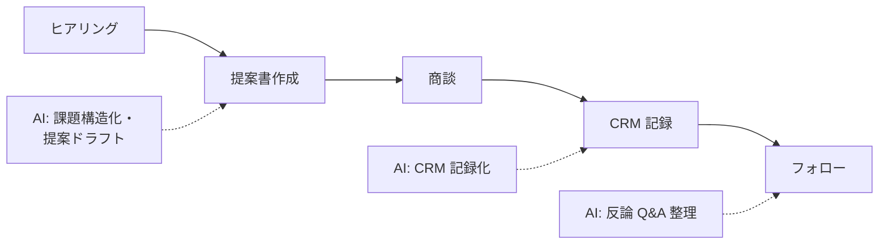

営業の AI 活用は「速く資料を作る」だけでは失敗します。重要なのは**顧客理解を深める時間を AI で捻出する**こと。そして「価格・納期・仕様の約束」は必ず人間が管理します。

## 業務の全体像

- 提案書・見積書の作成
- 商談（ヒアリング・提案・調整）
- 商談記録の CRM 入力と引継ぎ
- 既存顧客のフォロー（カスタマーサクセス）

## AI が効きそうな場面

| 業務 | AI の関わり方 | 人間に残る役割 |
|---|---|---|
| 提案書 | 顧客課題に合わせた構成・文案ドラフト | 課題の解釈・価格・約束 |
| 商談記録 | 録音/メモからの CRM 記録化 | 登録内容の確認・次回戦略 |
| 反論対応 | Q&A セットの整備・ロールプレイ | 実際の回答（責任） |

## この領域特有の制約

- **誇大表現・競合比較の規制**（景表法・優越的地位の濫用等）に触れる文案を AI が生成しない設計
- 顧客情報の取り扱い（CRM 外への入力ルール）
- AI が作った提案に営業自身が「納得していない」状態で客先に出さない

## ユースケース

- [提案書ドラフトの作成](./use-cases/proposal-drafting.md)

## AI 導入マップ（業務フロー × AI の掛かる場所）

<!-- generated:phase-playbook -->
## 法令・ガイドライン（着手前に一次情報で確認）

保存期間・届出などの具体的な要件は改正されるため、このサイトでは数値を転記せず、一次情報へのリンクのみを載せています。案件ごとに原文と顧客の社内規程で確認してください。

| 法令・ガイドライン | 関係する論点 |
|---|---|
| [個人情報保護委員会「生成 AI サービスの利用に関する注意喚起」](https://www.ppc.go.jp/news/careful_information/230602_AI_utilize_alert/) | 個人データを入力する場合の利用目的・学習利用の確認 |
| [不当景品類及び不当表示防止法（景品表示法）](https://laws.e-gov.go.jp/law/337AC0000000134) | 提案資料の表示 |
| [中小受託取引適正化法（旧 下請法）](https://laws.e-gov.go.jp/law/331AC0000000120) | 発注・取引条件 |

## 判断表: どこまで AI に任せるか

| 業務の種類 | 推奨する自動化の度合い | 確定する人 |
|---|---|---|
| 検索・要約・分類（社内向け） | AI が実行し、事後に抜き取り確認 | 担当営業・営業マネージャー |
| 下書き（社外・利用者向け） | AI が下書きし、人が確認して確定 | 担当営業・営業マネージャー |
| 価格・納期・契約条件の約束 | AI は根拠の提示・論点整理まで | 担当営業・営業マネージャー |

## 成果指標の例

商談記録の入力時間、提案書の作成時間、CRM の入力率。測り方とベースラインの取り方は[要件化と成果指標](/guide/requirements-and-kpi)を参照。

## 評価セットに必ず入れるケース

価格・納期の約束が含まれる商談、競合比較、録音の聞き取りにくい会議。評価の作り方は[評価](/guide/evaluation)を参照。

## 工程別の要点（営業・カスタマーサクセス × 工程）

| 工程 | 方式 | 主な成果物 |
|---|---|---|
| [要件定義](/matrix/sales/waterfall/requirements) | ウォーターフォール | 成果指標合意書（業務指標・品質指標・ガードレール・判断者） |
| [設計](/matrix/sales/waterfall/design) | ウォーターフォール | 設計 1 枚紙（分担・パターン・入口・データ・人の確認・ログ・停止条件） |
| [実装](/matrix/sales/waterfall/implementation) | ウォーターフォール | 動くプロトタイプ・プロンプト資産・反復レポート |
| [テスト](/matrix/sales/waterfall/testing) | ウォーターフォール | 評価レポート（評価セットの版・指標・悪化ケース・判断） |
| [リリース](/matrix/sales/waterfall/deployment) | ウォーターフォール | 本番化判断資料（品質・業務効果・統制・コスト・展開計画） |
| [運用・改善](/matrix/sales/waterfall/maintenance) | ウォーターフォール | 運用移管書・週次レビュー記録 |
| [スプリントプランニング](/matrix/sales/agile/sprint-planning) | アジャイル | スプリントゴールと試用計画 |
| [バックログリファインメント](/matrix/sales/agile/backlog-refinement) | アジャイル | 優先度付きバックログ |
| [デイリースクラム](/matrix/sales/agile/daily-scrum) | アジャイル | 日次メモ |
| [レビュー](/matrix/sales/agile/review) | アジャイル | 反復レポート・合意事項 |
| [レトロスペクティブ](/matrix/sales/agile/retrospective) | アジャイル | 改善アクション（次スプリントで実施） |

## よくある落とし穴

- **価格・納期・契約条件の約束まで AI に任せる設計にする**: 責任の所在が曖昧になり、統制部門の承認が下りない
- **CRM・SFAと別の画面を作る**: 二重入力になり、現場が使わなくなる
- **顧客の担当者情報・商談条件を分類せずに入力する**: 着手後に作り直しになる
- **変化（商品ラインナップ・価格表・営業方針）を監視しない**: 静かに品質が劣化する

## チェックリスト

- [ ] 上の法令・ガイドラインを一次情報で確認した
- [ ] 人に残す判断を業務オーナーと合意した
- [ ] CRM・SFAとの連携方法を情シスと確認した
- [ ] 評価セットに難しいケースを含めた

## 参考: 中国の事例（Datawhale『FDE案例100』）

以下は**中国の事例**を本サイトが要約したものです。詳細は原典を確認してください（[事例集の紹介ページ](/references/datawhale-fde100)）。

- **NO.17**: 受注生産の見積り支援（出典: Datawhale『FDE案例100』第一册 NO.17、[PDF](https://assets.datawhale.cn/Datawhale%20FDE%E6%A1%88%E4%BE%8B100.pdf) / [fde100.datawhale.cn](https://fde100.datawhale.cn)）
- **NO.18**: 上場バイオ企業で、紙の台帳から営業データ分析、さらに営業教育・採用へ段階的に拡大（出典: Datawhale『FDE案例100』第一册 NO.18、[PDF](https://assets.datawhale.cn/Datawhale%20FDE%E6%A1%88%E4%BE%8B100.pdf) / [fde100.datawhale.cn](https://fde100.datawhale.cn)）
- **NO.23**: 建機レンタルの問い合わせ獲得と見積り。納品後に効果を追跡しなかったことを反省点に挙げている（出典: Datawhale『FDE案例100』第一册 NO.23、[PDF](https://assets.datawhale.cn/Datawhale%20FDE%E6%A1%88%E4%BE%8B100.pdf) / [fde100.datawhale.cn](https://fde100.datawhale.cn)）
