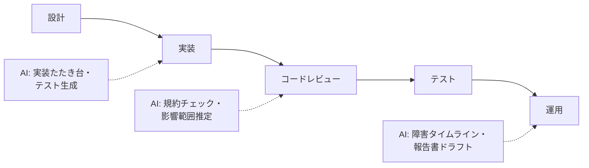

ソフトウェア開発は AI 協働が最も進んでいる領域の一つ。ただし「AI にコードを書かせる」だけでは FDE ではなく、**各工程で判断権がどこにあるか**の設計が本質です。

## 業務の全体像

- 要件定義・設計
- 実装・コードレビュー
- テスト・デバッグ
- リリース・運用（障害対応、ドキュメント整備）

## AI が効きそうな場面

| 業務 | AI の関わり方 | 人間に残る役割 |
|---|---|---|
| 実装 | 定型的な実装・テストコードの下書き | 設計判断・アーキテクチャ決定 |
| コードレビュー | 規約チェック・影響範囲推定・一次指摘 | 設計の妥当性・業務適合の判断 |
| デバッグ | エラー原因の仮説生成・ログ分析 | 根因の特定と修正方針の決定 |
| 障害対応 | タイムライン整理・類似障害の検索 | 対応判断・対外説明 |

## この領域特有の制約

- 生成コードのライセンス・社外秘コードの取り扱い（利用規約の確認は必須）
- 「動くからOK」ではない: セキュリティ・性能の観点は人間の検証が必要
- AI 生成コードの**レビュー負荷が逆に増える**問題 → レビューの型設計が重要

## ユースケース

- [プルリクエストレビュー支援](./use-cases/pr-review-assistant.md)

## AI 導入マップ（業務フロー × AI の掛かる場所）

<!-- generated:phase-playbook -->
## 法令・ガイドライン（着手前に一次情報で確認）

保存期間・届出などの具体的な要件は改正されるため、このサイトでは数値を転記せず、一次情報へのリンクのみを載せています。案件ごとに原文と顧客の社内規程で確認してください。

| 法令・ガイドライン | 関係する論点 |
|---|---|
| [著作権法](https://laws.e-gov.go.jp/law/345AC0000000048) | 生成物・学習データ・引用の扱い |
| [OWASP Top 10 for LLM Applications 2025](https://genai.owasp.org/resource/owasp-top-10-for-llm-applications-2025/) | LLM を組み込むアプリの脆弱性 |
| [個人情報保護委員会「生成 AI サービスの利用に関する注意喚起」](https://www.ppc.go.jp/news/careful_information/230602_AI_utilize_alert/) | 個人データを入力する場合の利用目的・学習利用の確認 |

## 判断表: どこまで AI に任せるか

| 業務の種類 | 推奨する自動化の度合い | 確定する人 |
|---|---|---|
| 検索・要約・分類（社内向け） | AI が実行し、事後に抜き取り確認 | コードオーナー・テックリード |
| 下書き（社外・利用者向け） | AI が下書きし、人が確認して確定 | コードオーナー・テックリード |
| 本番リリースの判断・セキュリティ例外の承認 | AI は根拠の提示・論点整理まで | コードオーナー・テックリード |

## 成果指標の例

レビュー待ち時間、障害報告書の作成時間、リードタイム（着手から本番まで）。測り方とベースラインの取り方は[要件化と成果指標](/guide/requirements-and-kpi)を参照。

## 評価セットに必ず入れるケース

複数モジュールにまたがる変更、セキュリティに関わる変更、再現手順が曖昧な障害。評価の作り方は[評価](/guide/evaluation)を参照。

## 工程別の要点（ソフトウェア開発 × 工程）

| 工程 | 方式 | 主な成果物 |
|---|---|---|
| [要件定義](/matrix/software-development/waterfall/requirements) | ウォーターフォール | 成果指標合意書（業務指標・品質指標・ガードレール・判断者） |
| [設計](/matrix/software-development/waterfall/design) | ウォーターフォール | 設計 1 枚紙（分担・パターン・入口・データ・人の確認・ログ・停止条件） |
| [実装](/matrix/software-development/waterfall/implementation) | ウォーターフォール | 動くプロトタイプ・プロンプト資産・反復レポート |
| [テスト](/matrix/software-development/waterfall/testing) | ウォーターフォール | 評価レポート（評価セットの版・指標・悪化ケース・判断） |
| [リリース](/matrix/software-development/waterfall/deployment) | ウォーターフォール | 本番化判断資料（品質・業務効果・統制・コスト・展開計画） |
| [運用・改善](/matrix/software-development/waterfall/maintenance) | ウォーターフォール | 運用移管書・週次レビュー記録 |
| [スプリントプランニング](/matrix/software-development/agile/sprint-planning) | アジャイル | スプリントゴールと試用計画 |
| [バックログリファインメント](/matrix/software-development/agile/backlog-refinement) | アジャイル | 優先度付きバックログ |
| [デイリースクラム](/matrix/software-development/agile/daily-scrum) | アジャイル | 日次メモ |
| [レビュー](/matrix/software-development/agile/review) | アジャイル | 反復レポート・合意事項 |
| [レトロスペクティブ](/matrix/software-development/agile/retrospective) | アジャイル | 改善アクション（次スプリントで実施） |

## よくある落とし穴

- **本番リリースの判断・セキュリティ例外の承認まで AI に任せる設計にする**: 責任の所在が曖昧になり、統制部門の承認が下りない
- **Git リポジトリ・CI・チケット管理と別の画面を作る**: 二重入力になり、現場が使わなくなる
- **ソースコード・認証情報・顧客データを分類せずに入力する**: 着手後に作り直しになる
- **変化（依存ライブラリ・API・モデルの更新）を監視しない**: 静かに品質が劣化する

## チェックリスト

- [ ] 上の法令・ガイドラインを一次情報で確認した
- [ ] 人に残す判断を業務オーナーと合意した
- [ ] Git リポジトリ・CI・チケット管理との連携方法を情シスと確認した
- [ ] 評価セットに難しいケースを含めた

