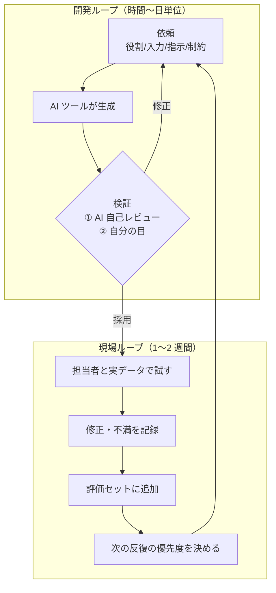

## この章のゴール

- 現場の担当者を巻き込んだ**短い反復**（1〜2 週間）でプロトタイプを育てられる
- AI コーディングツールへの依頼を**4 部品の型**で書き、検証を 2 段階で回せる
- 反復ごとに「試した結果」を評価データに還元し、改善を数字で追える

## 2 つのループ

FDE の構築は、自分の開発ループと、現場との反復ループの 2 重になっています。



## 開発ループ: 依頼の 4 部品

| 部品 | 例 |
|---|---|
| **役割** | 「あなたはこのリポジトリの実装補助です」 |
| **入力** | 設計 1 枚紙・状態一覧・既存コードの該当箇所・サンプルデータ（マスキング済み） |
| **指示** | 「①〜③の状態を実装。テストは境界値を含める」 |
| **制約** | 「新規依存は提案のみ」「仕様にない判断は assumptions に書く」「実データを使わない」 |

**制約（やらないこと）が最も効きます。** 否定形の制約を書く習慣が品質を分けます。

### 検証の 2 段階

1. **AI に自己レビューさせる**: 「この差分をシニアエンジニアとしてレビューし、重大な問題だけ挙げよ」
2. **自分の目で最終確認**: 理解できない行は採用しない。説明を求めても理解できなければ書き直す

## 現場ループ: 1 反復の進め方

| 日 | やること | 成果物 |
|---|---|---|
| 1 日目 | 反復のゴールを 1 つ決める（例: 「根拠表示を付ける」） | 反復メモ |
| 2〜6 日目 | 実装・自分でのテスト | 動くプロトタイプ |
| 7 日目 | 担当者 2〜3 名と実データ 10〜20 件で試す（同席） | 試用記録 |
| 8 日目 | 修正された出力・不満を評価セットに追加し、指標を再計測 | 評価結果 |
| 9〜10 日目 | 業務オーナーへ報告、次の反復を決める | 反復レポート |

**同席がポイントです。** 試用を「使ってみてください」で任せると、使われないか、感想が「なんとなく微妙」になります。隣で操作を見て、手が止まった箇所を記録します。

## 判断表: 次の反復で何を直すか

| 観察されたこと | 直すべきもの | 直さないもの |
|---|---|---|
| 出力の内容が間違っている | 入力データ・検索・プロンプト | UI |
| 内容は正しいが使われない | 業務画面への組み込み・操作手順 | プロンプト |
| 担当者が出力を毎回大きく直す | 出力形式・文体の例（[Few-shot](/patterns/few-shot)） | モデルの変更（最後の手段） |
| 例外ケースで破綻する | 例外を人に回す分岐 | 例外まで AI に解かせる |
| 遅い・高い | モデルの使い分け・キャッシュ | 品質を犠牲にした削減 |

## 例示: 回答下書きの 3 反復（架空のケース）

> 手法の説明用の**架空の例**です。数値は例示です。

| 反復 | ゴール | 試用で分かったこと | 評価 |
|---|---|---|---|
| 1 | 過去対応を検索して下書き | 内容は概ね正しいが、担当者が根拠を確かめるため結局検索し直していた | 採用率 40% |
| 2 | 下書きに根拠（過去対応の番号・日付）を表示 | 確認が速くなった。敬語の癖が強く毎回直されている | 採用率 55% |
| 3 | 社内の模範回答 5 件を例として与える | 修正量が減った。返品に関する問い合わせだけ誤りが多い | 採用率 68%、返品は人に回す分岐を追加 |

## テンプレート: プロンプト資産と反復レポート

```text
# プロンプト資産（Git 管理）
名前: answer-draft v3
目的: 過去対応を根拠に回答下書きを作る
入力: {問い合わせ本文}, {検索結果 上位 5 件}
制約: 根拠のない記述をしない / 返品は「担当者確認」とだけ出力
改訂履歴: v2 根拠表示 / v3 模範回答 5 件を例示
評価: 評価セット v3（60 件）で採用率 {値}
```

```text
# 反復レポート（{n} 回目）
ゴール: {…}
試用: {日付}・{担当者}・{件数}
結果: 業務指標 {値} / 品質指標 {値}（前回 {値}）
分かったこと: {…}
次の反復: {…}
判断が必要なこと: {…}
```

## よくある落とし穴

- **生成の速さに引きずられて検証を省く**: 手戻りの方が遥かに遅い
- **試用を任せきりにする**: 使われない理由が分からない
- **プロンプトを Git 管理しない**: どの変更で品質が変わったか追えない
- **最初から完成度を上げる**: 2 週間を超える反復は、現場の関心が離れる

## チェックリスト

- [ ] 依頼の 4 部品で AI ツールに依頼している
- [ ] 検証を 2 段階で回している
- [ ] 反復ごとに担当者と同席して試用した
- [ ] 試用結果を評価セットに追加した
- [ ] プロンプトを Git で管理し、改訂履歴を残した

## 関連

- [小技集](/references/prompt-tips) — プロンプトとツールの実戦テクニック
- [実演記録](/references/oss-experiment) — FDE × AI の実際の作業分割
- 工程: [実装](/process/waterfall/implementation)・[スプリント計画](/process/agile/sprint-planning)・[レビュー](/process/agile/review)
- 次の章: [評価](/guide/evaluation)
