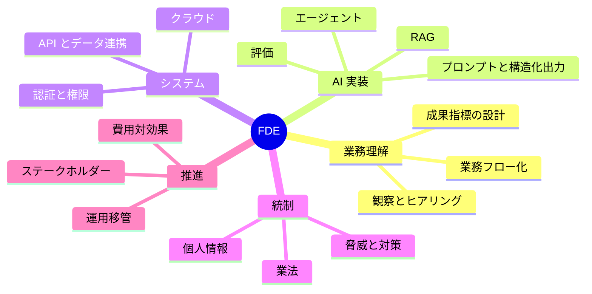

## この章のゴール

- 自分の出発点と、FDE に必要なスキルとの差分を把握する
- 3 段階（基礎 → 一気通貫 → 領域 × 工程）で、何をどの順に身につけるか決める
- 採用・案件獲得で通用する**実績の見せ方**を準備する

## FDE のスキルマップ



## 3 段階のロードマップ

| 段階 | 状態 | 身につけること | 到達の目安（成果物） |
|---|---|---|---|
| 1. 基礎 | AI ツールを自分の仕事で使いこなす | [構築ループ](/guide/build-loop)・[パターン](/patterns)（Structured Output・RAG・Evaluation） | 自分の業務を対象にした小さなツールと評価セット |
| 2. 一気通貫 | 1 つの業務を発見から定着まで回せる | [発見](/guide/discovery)〜[ステークホルダー](/guide/stakeholders) の全章 | 課題定義シート・合意書・評価レポート・本番化判断資料の 1 セット |
| 3. 領域 × 工程 | 業界ごとの型を持ち、繰り返し成果を出せる | [領域別プレイブック](/domains)・[工程](/process)・[マトリクス](/matrix) | 同じ領域で 2 件以上の導入実績と、横展開の型 |

## 出発点別: 最初の 3 か月

### エンジニアから

| 強み | 補うもの | 最初の一歩 |
|---|---|---|
| 実装・AI ツール | 業務観察、成果指標、顧客との合意形成 | 社内の非エンジニア部署の業務を 1 つ観察し、[課題定義シート](/guide/discovery)を書く |

### コンサルタント・PM から

| 強み | 補うもの | 最初の一歩 |
|---|---|---|
| 業務整理・合意形成 | 自分で作る力、評価の設計 | AI コーディングツールで、整理した業務の下書きツールを自作し、評価セット 30 件で測る |

### 業務担当（現場）から

| 強み | 補うもの | 最初の一歩 |
|---|---|---|
| 業務知識・現場の信頼 | 実装・システム連携・統制 | 自分の業務で [Structured Output](/patterns/structured-output) を使った抽出ツールを作り、同僚に使ってもらう |

## 実績（ポートフォリオ）の作り方

採用・案件獲得では、「何を作ったか」より「**何がどれだけ変わったか**」が問われます（[採用ガイド](/guide/hiring)の面接質問を参照）。守秘義務の範囲で、次の形にまとめます。

```text
# 実績 {n}
業務: {業界}・{業務の種類}（顧客名は伏せる）
課題: {誰が何に困っていたか}
自分の役割: {発見 / 要件化 / 実装 / 評価 / 本番化 / 定着 のどこを担ったか}
設計: {パターン}、人の確認ポイント {…}
結果: {業務指標} {前}→{後}（{計測方法}）
うまくいかなかったこと: {…} と、その対処
```

公開できる実績がない場合は、公開データや自分の業務を題材にした事例を作り、評価セットと評価結果まで公開すると説得力が出ます。このナレッジベースの[実演記録](/references/oss-experiment)もその一例です。

## 市場で求められていること

フリーランス案件の要件に頻出するスキルと件数の推移は [市場データ](/market) と [需要分析](/references/market-demand) で確認できます。

## よくある落とし穴

- **ツールの資格・講座だけを積み上げる**: 業務を変えた実績にはならない
- **技術の幅を広げすぎる**: まず 1 つの業務を一気通貫で回すことが先
- **失敗を隠す**: 「うまくいかなかったこと」を言語化できる人が現場で信頼される

## チェックリスト

- [ ] 自分の出発点と補うスキルを書き出した
- [ ] 3 か月以内の最初の一歩を決めた
- [ ] 実績を「業務指標の変化」の形で 1 件書いた

## 関連

- [面接対策](/guide/interview-prep)
- [FDE とは何か](/guide/what-is-fde)
