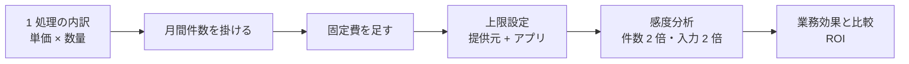

## この章のゴール

- 1 処理あたりのコストを**単価 × 使用量**で積み上げ、固定費と変動費を分けて提示できる
- 暴走を防ぐ**上限設定**の場所を答えられる
- 業務時間の削減を金額に換算し、**ROI の前提を明示した**試算を作れる

## 原則: 顧客が怖れるのは「金額」より「読めないこと」

従量課金の生成 AI は、使われるほど費用が増えます。顧客が知りたいのは「1 件いくらか」「上限はどこで止まるか」「利用が 2 倍になったらどうなるか」の 3 点です。



## 手順 1: コストを積み上げる

1. 1 処理で呼ぶサービスを列挙する（文字起こし・OCR・検索・LLM 入力・LLM 出力）
2. それぞれの**公式価格ページの単価**と、1 処理あたりの数量（分・ページ・トークン）を掛ける
3. 月間件数を掛け、固定費（検索サービスの基本料金など）を足す
4. 再試行・長文入力・同時実行で**2 倍以上ぶれる**ことを前提に、感度分析を付ける

以下の計算例の単価は 2026-09-13 時点で各社の公開価格ページから取得したものです。価格は変更されるため、提案時は必ず公式ページで再確認してください。

### 計算例 1: 議事録システム（AWS、会議 30 分）

| 項目 | 単価 | 数量 | 小計 |
|---|---|---|---|
| Transcribe（文字起こし） | $0.024/分 | 30 分 | $0.72 |
| Bedrock Claude 入力（議事録用プロンプト + 全文） | $3/MTok | 20k tokens | $0.06 |
| Bedrock Claude 出力（要約 + アクション JSON） | $15/MTok | 2k tokens | $0.03 |
| **合計（1 会議）** | | | **約 $0.81** |

- 月 50 会議 → **約 $40/月**。話者分離オプションで +50% 程度
- 上限設定: AWS Budgets で「実費 80% 到達で通知、100% でアラート」+ Bedrock はアプリ側で 1 日のリクエスト数上限も実装

### 計算例 2: 契約レビュー支援（Azure、契約 20 ページ）

| 項目 | 単価 | 数量 | 小計 |
|---|---|---|---|
| Document Intelligence（Read） | 約 $1.50/1,000 ページ | 20 ページ | $0.03 |
| Azure OpenAI 入力（雛形 + 差分プロンプト） | $2.50/MTok | 30k tokens | $0.075 |
| Azure OpenAI 出力（差分整理 JSON） | $10/MTok | 3k tokens | $0.03 |
| AI Search（Basic 層） | 約 $75/月 | 固定 | $75/月 |
| **合計（1 契約、固定費除く）** | | | **約 $0.14** |

- 月 100 契約 → 変動費約 $14 + 固定費 $75。**固定費が支配する**ので、月契約数が少ない顧客には Basic でも十分
- 上限設定: Azure OpenAI リソースの Tokens-per-minute quota + Cost Management のアラート

### 計算例 3: 社内規程 Q&A（AWS、質問 1,000 件/月）

| 項目 | 単価 | 数量 | 小計 |
|---|---|---|---|
| Bedrock Knowledge Bases（検索 + 生成、Haiku 級） | 入力 $0.25/MTok | 3k tokens/問 | $0.75 |
| 同出力 | $1.25/MTok | 0.5k tokens/問 | $0.63 |
| **合計（1,000 問/月）** | | | **約 $1.4/月** |

- 1 問あたり約 $0.0014。**対話型 Q&A は Haiku 級モデルで十分**なケースが多い。精度が足りない質問だけ Sonnet にフォールバックする 2 段構成がコスト最適の定番


## 手順 2: 上限を設定する

| 層 | 設定する場所 | 例 |
|---|---|---|
| 提供元 | クラウドの予算アラート・API の利用上限 | 予算の 80% で通知、100% でアラート |
| アプリ | 1 ユーザー・1 日あたりのリクエスト上限 | 上限超過時は「明日以降に再実行」 |
| 設計 | モデルの使い分け | 簡単な問いは小型モデル、難しい問いだけ大型モデルへ |

## 手順 3: ROI を試算する

業務効果は「**削減時間 × 人件費単価**」で金額に換算するのが最も説明しやすい型です。

```text
年間効果 = 月間件数 × 1 件あたり削減時間 × 時間単価 × 12
年間費用 = （変動費 + 固定費）× 12 + 構築費 + 運用人件費
ROI     = （年間効果 − 年間費用）÷ 年間費用
```

**必ず前提を書きます**: 削減時間の計測方法（何件で、誰が測ったか）、時間単価の根拠、削減された時間が何に使われるか。削減時間がそのまま人件費削減になるとは限らないため、「創出された時間」として示し、使い道を業務オーナーと合意するのが現実的です。

### 公開事例の数字の読み方

| 事例 | 公表された数字 | 読み方 |
|---|---|---|
| パナソニック コネクト（社内 AI アシスタント 3 年目） | 年間 78.8 万時間削減（総労働時間の 3.4%）、利用 361 万回、1 回あたり約 33 分削減 | 「利用回数 × 1 回あたり削減時間」で全社効果を出す型。1 回あたりの削減時間の算出方法も併せて確認する（[出典](https://news.panasonic.com/jp/press/jn260729-1)） |
| Klarna（AI アシスタント、提供開始 1 か月） | 230 万件の会話、カスタマーサービスのチャットの 3 分の 2 を処理、700 人のフルタイム担当者相当、解決時間 11 分→2 分未満 | 「人員換算」で示す型。対応品質（再問い合わせ 25% 減）も併記している（[出典](https://www.klarna.com/international/press/klarna-ai-assistant-handles-two-thirds-of-customer-service-chats-in-its-first-month/)） |

ほかの事例は [公開事例集](/references/case-studies) を参照してください。

## 例示: 規程 Q&A の ROI 試算（架空のケース）

> 手法の説明用の**架空の例**です。数値はすべて例示で、実在の企業のものではありません。

| 項目 | 値 | 前提 |
|---|---|---|
| 月間質問数 | 1,000 件 | 人事への問い合わせログ 3 か月平均 |
| 1 件あたり削減時間 | 10 分 | 質問者と人事担当の合計、20 件実測 |
| 時間単価 | 4,000 円 | 顧客の人事部が提示した社内標準単価 |
| 年間効果 | 約 800 万円 | 1,000 × 10/60 × 4,000 × 12 |
| 年間費用 | API・検索・運用人件費の合計 | 計算例 3 と運用工数から算出 |

## テンプレート: 見積もり 1 枚

```text
1 処理あたり: {サービス}{単価} × {数量} = {小計}（内訳 3〜5 行）
月間想定: {件数} 件 × {小計} + 固定費 {値} = {月額}
上限設定: 提供元 {値} / アプリ {値}
感度分析: 件数 2 倍で {値}、入力 2 倍で {値}
業務効果: {件数} × {削減時間} × {単価} = {年額}（前提: {計測方法}）
価格の取得日: {日付}（公式ページ: {URL}）
```

## よくある落とし穴

- **トークン単価だけで見積もる**: 検索サービスの固定費、OCR、再試行が抜ける
- **価格を転記したまま更新しない**: 提案時に必ず公式ページで再確認する
- **削減時間 = 人件費削減と書く**: 経営層の信頼を失う。創出時間とその使い道で示す
- **上限を設定しない**: 1 日で月の予算を使い切る事故が起きる

## チェックリスト

- [ ] 1 処理あたりの内訳を単価 × 数量で示した
- [ ] 固定費と変動費を分けた
- [ ] 提供元とアプリの両方に上限を設定した
- [ ] 感度分析を付けた
- [ ] ROI の前提（計測方法・単価の根拠）を書いた

## 計算例の出典

| 単価 | 出典 |
|---|---|
| Claude Sonnet $3/$15 per MTok | https://docs.anthropic.com（Pricing） |
| GPT-4o $2.50/$10 per MTok | https://openai.com/api/pricing/ |
| Amazon Transcribe $0.024/分 | https://aws.amazon.com/transcribe/pricing/ |
| Azure AI Search Basic 約 $75/月 | https://azure.microsoft.com/pricing/details/search/ |
| Document Intelligence 約 $1.50/1,000 ページ | https://azure.microsoft.com/pricing/details/ai-document-intelligence/ |

数値は地域・契約・モデル改定で変わる。**提案書に載せる際は、その日の価格ページの URL と取得日を一緒に記録する。**
