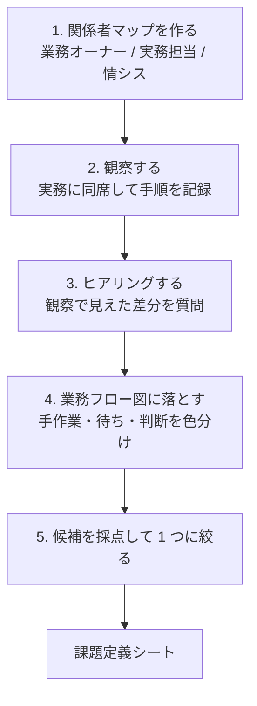
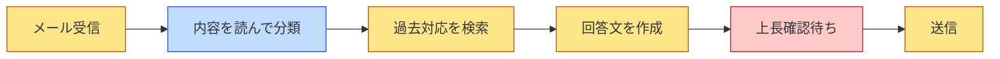

## この章のゴール

- ヒアリングの前に**観察**から入り、手順書と実際の業務の差を見つけられる
- 課題候補を業務フロー図に落とし、**AI 適性 × 効果 × 実現性**で採点して最初の 1 業務を選べる
- 発見フェーズの成果物（課題定義シート）を 1 枚で出せる

## なぜ発見がいちばん重要か

Gartner は生成 AI プロジェクトが PoC 後に放棄される要因の一つに「ビジネス価値の不明確さ」を挙げています（[出典](https://www.gartner.com/en/newsroom/press-releases/2024-07-29-gartner-predicts-30-percent-of-generative-ai-projects-will-be-abandoned-after-proof-of-concept-by-end-of-2025)）。IPA の調査でも、日本企業の生成 AI 導入課題として「効果やリスクに関する理解不足」が上位で、「生成 AI を活用できそうな業務がない」とする回答も約 4 分の 1 ありました（[出典: IPA DX 動向 2025 説明会資料](https://www.ipa.go.jp/event/2025/tbl5kb0000001rzs-att/dx-trend-2025-Webinar-Handouts.pdf)）。

つまり「どこに使えば効くか」を見つけること自体が、顧客にとって最も価値のある仕事です。

## 方法: 5 ステップ



### ステップ 1: 関係者マップ

| 役割 | 聞くこと | 典型的な所属 |
|---|---|---|
| 業務オーナー | 何が困っているか、何が改善したら成功か | 部長・課長 |
| 実務担当 | 実際の手順、例外、時間がかかる箇所 | 担当者・パート |
| 情報システム | 使えるデータ・サービス・権限 | 情シス・DX 推進室 |
| 統制部門 | 個人情報・法令・監査の制約 | 法務・コンプライアンス |

### ステップ 2: 観察（ヒアリングより先に）

手順書やヒアリングで語られる業務と、実際の業務は異なります。最低 1 回は**実務に同席**し、次を記録します。

- 1 件あたりの所要時間（ストップウォッチで測る）
- 画面・紙・システムの切り替え回数
- 「確認のため」に別の人へ聞きに行く回数
- 例外処理（手順書にないこと）の頻度

### ステップ 3: ヒアリング

観察で見えた差分を中心に質問します。**「AI で何をしたいですか」とは聞かない**（答えられない質問です）。

| 聞くべき質問 | 狙い |
|---|---|
| 「この作業で一番時間がかかるのはどこですか」 | ボトルネック特定 |
| 「この判断はどんな情報を見て決めていますか」 | AI に渡す入力の特定 |
| 「新人がよく間違えるのはどこですか」 | 暗黙知の在りか |
| 「間違えるとどうなりますか、誰が気づきますか」 | リスクと人の確認ポイント |
| 「これが半分の時間になったら、空いた時間で何をしますか」 | 効果の実感・定着の動機 |

### ステップ 4: 業務フロー図

観察とヒアリングの結果を、手作業・待ち・判断を区別したフロー図にします。



黄色（手作業の転記・検索・下書き）は AI の候補、青（判断）は人に残す候補、赤（待ち）は AI ではなくプロセス変更で解く候補です。

### ステップ 5: 採点して絞る

| 軸 | 1 点 | 3 点 | 5 点 |
|---|---|---|---|
| **AI 適性** | ルールで書ける / 正解が 1 つで誤りが致命的 | 下書き＋人の確認で成立 | 文章の読解・分類・要約・下書きが中心 |
| **効果** | 月数時間 | 月数十時間 | 月数百時間、または品質・リードタイムに直結 |
| **実現性** | データが取れない・権限が下りない | データはあるが整備が必要 | データ・権限・担当者の協力が揃う |
| **測りやすさ** | 効果を数字で測れない | 抜き取りで測れる | 業務システムのログで自動で測れる |

合計点が最も高いものから選びますが、**最初の 1 件は「実現性」と「測りやすさ」が 4 点以上**のものに限ると、PoC の結果で次の稟議を通しやすくなります。

## 例示: 問い合わせ対応部門の発見（架空のケース）

> 以下は手法の説明用の**架空の例**です。数値はすべて例示です。

- 観察で、担当者は 1 件あたり「過去対応の検索」に最も時間を使っていた。手順書には検索の手順が書かれていなかった
- ヒアリングで「新人は過去対応の場所が分からず先輩に聞く」ことが分かった
- 候補は 3 つ: ①回答下書き ②問い合わせ分類 ③上長確認の省略
- 採点: ①は AI 適性 5・効果 4・実現性 4・測りやすさ 4、②は AI 適性 5・効果 2、③は AI 適性 1（プロセス変更の問題）
- 選定: ①「過去対応を根拠として示す回答下書き」。③は業務オーナーに別途プロセス改善として提案

## テンプレート: 課題定義シート

```text
# 課題定義シート
対象業務: {業務名}（業務オーナー: {氏名・役職}）
現状: 1 件あたり {所要時間}、月 {件数} 件、担当 {人数} 名（観察日 {日付}）
困りごと（一文）: 「{誰}が、{いつ}、{何}に困っている」
AI に任せる候補: {下書き / 分類 / 要約 / 抽出 …}
人に残す判断: {最終確認 / 例外判断 …}
採点: AI 適性 {n} / 効果 {n} / 実現性 {n} / 測りやすさ {n}
使えるデータ: {場所・形式・件数・個人情報の有無}
次のステップ: 要件化と成果指標の合意（{日付}）
```

## よくある落とし穴

- **「全社の AI 活用方針」から始める**: 業務が特定されないまま、PoC の評価基準も決まらない
- **ヒアリングだけで要件を書く**: 手順書と実務の差（例外・暗黙知）を取りこぼす
- **待ち時間を AI で解こうとする**: 承認待ちはプロセス・権限の問題
- **データの所在を後で確認する**: 発見段階で「どこに、何件、どんな形式で」を確認しないと構築で止まる

## チェックリスト

- [ ] 関係者マップ（業務オーナー・実務担当・情シス・統制部門）を作った
- [ ] 実務に 1 回以上同席し、所要時間を測った
- [ ] 業務フロー図で手作業・判断・待ちを色分けした
- [ ] 候補を 4 軸で採点し、1 つに絞った
- [ ] 課題定義シートを業務オーナーと共有した

## 関連

- 工程の詳細: [要件定義（ウォーターフォール）](/process/waterfall/requirements)・[バックログ精査（アジャイル）](/process/agile/backlog-refinement)
- 領域ごとの典型課題: [領域別プレイブック](/domains)
- 次の章: [要件化と成果指標](/guide/requirements-and-kpi)
