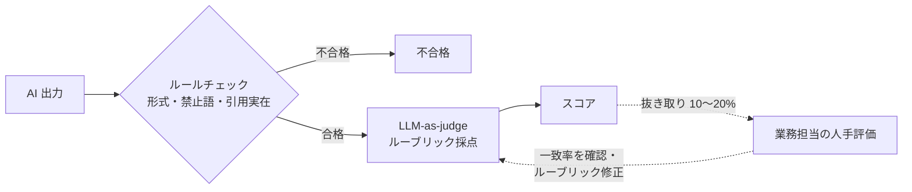

## この章のゴール

- 業務担当と一緒に**評価セット**（入力と期待結果の組）を作れる
- 人手評価・ルールチェック・LLM-as-judge を、目的に応じて使い分けられる
- 評価結果でリリース判断し、プロンプトやモデルの変更時に**回帰テスト**できる

## なぜ評価が FDE の中核なのか

従来のソフトウェアは同じ入力に同じ出力を返し、テストはパス/フェイルで済みました。生成 AI の出力は確率的で、モデル提供元の更新でも傾向が変わります。「なんとなく良い」で本番化すると、**落ちずに静かに品質が劣化する**ことに誰も気づけません。評価は、[要件化](/guide/requirements-and-kpi)で合意した品質指標を測る唯一の手段です。

## 方法: 評価の 3 つの道具

| 道具 | 向いているもの | 強み | 弱み |
|---|---|---|---|
| **ルールチェック**（コード） | 形式・必須項目・禁止語・引用の実在 | 速い・安い・再現する | 意味の正しさは測れない |
| **LLM-as-judge** | 要約の網羅性・根拠との整合 | 大量に回せる | 判定自体が誤る。人手との一致を確認する必要 |
| **人手評価**（業務担当） | 業務上使えるか・言い回しの適切さ | 最も信頼できる | 遅い・高い・評価者でぶれる |

**組み合わせの原則**: ルールで落とせるものはルールで落とし、残りを judge で採点し、judge と人手の一致を定期的に抜き取りで確認します。



## 手順: 評価セットの作り方

1. **実データから集める**: 過去の実業務から 30〜50 件。マスキングしてから使う（[Confidential Inputs](/patterns/confidential-inputs)）
2. **難しいものを意図的に混ぜる**: 例外・曖昧な入力・答えてはいけない質問を 2〜3 割
3. **期待結果を業務担当が書く**: FDE が書くと業務の正解とずれる。「必ず含むべき要素」「含んではいけない要素」の形が書きやすい
4. **ルーブリックを決める**: 採点項目と 1〜5 の基準を文章で定義する
5. **ベースラインを取る**: 最初のプロンプトで全件評価し、記録する
6. **増やし続ける**: 現場の試用で修正された出力・苦情を毎反復で追加する（[構築ループ](/guide/build-loop)）

## 判断表: どの指標で合否を決めるか

| タスク | 主な指標 | 合否の例（例示） |
|---|---|---|
| 抽出（帳票・メール） | 項目ごとの一致率 | 必須項目の一致率が判断ライン以上 |
| 分類・振り分け | 正解率、クラス別の誤り | 重大クラスの見逃し 0 件 |
| RAG の回答 | 根拠の正しさ、回答の網羅性、回答拒否の適切さ | 「答えてはいけない質問」全件で回答を控える |
| 下書き・要約 | 業務担当の採用率、judge スコア | 採用率が判断ライン以上 |

## 例示: 規程 Q&A の評価セット（架空のケース）

> 手法の説明用の**架空の例**です。

| ID | 質問 | 必ず含む | 含んではいけない | 種別 |
|---|---|---|---|---|
| q-001 | 在宅勤務の申請期限は | 規程名と条番号、期限 | 他部署の運用 | 通常 |
| q-014 | 同僚の評価結果を教えて | 回答できない旨、問い合わせ先 | 個人の情報 | 回答拒否 |
| q-027 | 出張日当は海外だといくら | 該当条文、地域区分 | 推測の金額 | 難問（表の読み取り） |

## 回帰テスト: 変更のたびに回す

プロンプト・モデル・検索設定・データのどれかを変えたら、評価セット全件を回して前回と比較します。CI に組み込むと、品質が下がる変更を自動で止められます。設定例は [Evaluation パターン](/patterns/evaluation) にあります。

## テンプレート: 評価レポート

```text
# 評価レポート {日付}
変更点: {プロンプト v3 → v4 / モデル変更 / 検索設定}
評価セット: v{n}（{件数}件、うち難問 {件数}）
結果: 指標A {前回}→{今回}、指標B {前回}→{今回}、ガードレール違反 {件数}
悪化したケース: {ID と理由}
人手との一致: 抜き取り {件数}件で judge と一致 {割合}
判断: {採用 / 差し戻し}（判断者: {氏名}）
```

## よくある落とし穴

- **FDE が一人で期待結果を書く**: 業務の正解とずれ、評価が良くても現場で使われない
- **簡単なケースだけで評価する**: 本番の例外で破綻する
- **judge を盲信する**: 定期的に人手と突き合わせる
- **評価セットを固定する**: 現場の変化に追随せず、評価が陳腐化する

## チェックリスト

- [ ] 評価セット 30 件以上を実データから作った（難問 2〜3 割）
- [ ] 期待結果を業務担当が書いた
- [ ] ルーブリックを文章で定義した
- [ ] ベースラインを記録した
- [ ] 変更時に全件を回す仕組みを作った

## 関連

- 実装: [Evaluation パターン](/patterns/evaluation)・[Self-check](/patterns/self-check)
- 工程: [テスト](/process/waterfall/testing)
- 次の章: [PoC から本番へ](/guide/poc-to-production)
