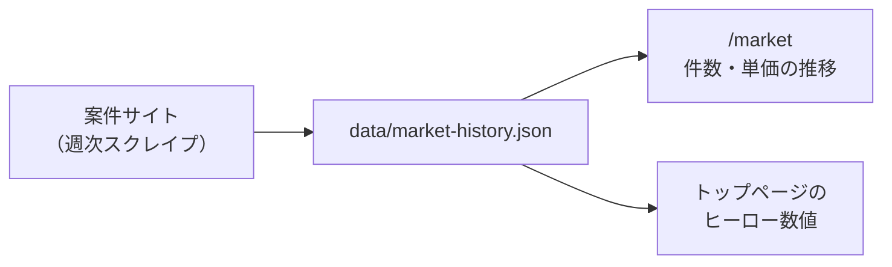

## この章のゴール

- 日本企業の生成 AI 導入の現在地を、**一次データ**で説明できる
- 日本の案件で FDE が必ずぶつかる商慣行（契約形態・稟議・情シス・現場の合意）に先回りできる
- 案件開始前に確認すべき国内ルール（ガイドライン・個人情報・業法）を一覧で把握する

## 1. 導入の現在地: 「大企業は使い始め、中小はこれから」

IPA「DX 動向 2025」（2025 年 2〜3 月調査）の説明会資料によると:

- 生成 AI を「導入済み・導入予定」の企業は、米独の 8 割に対し日本は 5 割強。中小企業では 2 割強にとどまる
- 生成 AI が**部署の業務プロセスに組み込まれている**割合は、米独の 4 割弱に対し日本は 1 割程度で、個人利用や試験利用にとどまる
- 不足が顕著な人材の上位は「データマネジメント知見 × 社内推進」「**現場知見 × AI の基礎知識**」「AI ツール活用 × 業務活用」で、いずれも 7 割を超える企業で不足

出典: [IPA プレスリリース 2025-06-26](https://www.ipa.go.jp/pressrelease/2025/press20250626.html)、[DX 動向 2025 本文](https://www.ipa.go.jp/digital/chousa/dx-trend/tbl5kb0000001mn2-att/dx-trend-2025.pdf)、[説明会資料](https://www.ipa.go.jp/event/2025/tbl5kb0000001rzs-att/dx-trend-2025-Webinar-Handouts.pdf)

**FDE にとっての含意**: 「個人利用・試験利用」から「業務プロセスへの組み込み」へ進める段階の案件、中小企業では「どの業務から始めるか」を一緒に決める段階の案件が中心になります。どちらも、ツール導入ではなく**業務への組み込み**が仕事の中心です。

## 2. 案件市場: 週次データで追う

このサイトはフリーランス案件サイトの FDE / AI 導入系案件を毎週集計しています。最新の件数・単価の中央値・推移は [市場データ](/market) を参照してください（数値はデータ更新ごとに自動で変わります）。読み方は [需要分析](/references/market-demand) にまとめています。

## 3. 日本の案件で必ず出てくる商慣行

| 商慣行 | FDE が困ること | 先回りの打ち手 |
|---|---|---|
| **準委任契約**が基本 | 「完成」の定義がなく、成果の議論が曖昧になる | 業務指標と測り方を別紙で合意（[要件化](/guide/requirements-and-kpi)・[成果物テンプレート](/references/deliverables)） |
| **稟議**と多段の承認 | 本番化の判断に数週間かかる | PoC 開始時点で「本番化の判断者・判断材料・時期」を決めておく（[本番化](/guide/poc-to-production)） |
| **情報システム部門**の統制 | クラウド・外部 API・データ持ち出しで止まる | 初週に情シスと面談し、データ分類と利用可能サービスを確認（[セキュリティ](/guide/security-governance)） |
| 現場の**暗黙知**と合意形成 | 手順書と実際の業務が違う | ヒアリングより先に観察（[発見](/guide/discovery)） |
| SIer・多重下請け構造 | 決定権者に直接届かない | 業務オーナーとの定例を契約条件に入れる（[ステークホルダー](/guide/stakeholders)） |

## 4. 着手前に確認する国内ルール

| ルール | 何が関係するか | 詳細 |
|---|---|---|
| 総務省・経産省「AI 事業者ガイドライン」 | AI の開発者・提供者・利用者それぞれの責務 | [総務省ページ](https://www.soumu.go.jp/main_sosiki/kenkyu/ai_network/02ryutsu20_04000019.html) |
| 個人情報保護法 | 個人データを生成 AI に入力する場合の利用目的・第三者提供 | [規制マップ](/references/ai-regulation) |
| 業法（弁護士法 72 条、医療関連ガイドラインなど） | 領域ごとに AI に任せてよい範囲が変わる | 各[領域プレイブック](/domains) |

詳しくは [セキュリティとガバナンス](/guide/security-governance) と [規制マップ](/references/ai-regulation) で扱います。

## 5. 公開事例に学ぶ「定着」の水準

パナソニック コネクトは社内 AI アシスタントの 3 年目の成果として、年間 78.8 万時間（総労働時間の 3.4%）の削減、利用回数 361 万回、1 回あたり約 33 分の削減を公表しています（[出典: パナソニック ニュースルーム 2026-07-29](https://news.panasonic.com/jp/press/jn260729-1)）。数字の出し方（利用回数 × 1 回あたり削減時間）は、日本企業の経営層に効果を説明するときの一つの型になります。ほかの事例は [公開事例集](/references/case-studies) にまとめています。

## よくある落とし穴

- **米国の FDE 論をそのまま持ち込む**: 日本では契約・承認・情シスの壁が先に来る。技術より段取りで負ける
- **「PoC はタダ同然で」**: 準委任で範囲が曖昧なまま始めると、本番化の判断材料が残らない
- **ルール確認を後回し**: 個人情報や業法の確認を構築後にすると、作り直しになる

## チェックリスト（案件開始前）

- [ ] 契約形態（準委任 / 請負）と、成果の測り方を別紙で合意した
- [ ] 本番化の判断者・判断時期・判断材料を決めた
- [ ] 情報システム部門と初回面談を設定した
- [ ] 扱うデータに個人情報・機微情報が含まれるか確認した
- [ ] 該当領域の業法・ガイドラインを[領域プレイブック](/domains)で確認した

## 参考文献

- IPA「[DX 動向 2025](https://www.ipa.go.jp/pressrelease/2025/press20250626.html)」
- 総務省「[AI 事業者ガイドライン](https://www.soumu.go.jp/main_sosiki/kenkyu/ai_network/02ryutsu20_04000019.html)」
- パナソニック コネクト「[生成 AI 導入 3 年の成果](https://news.panasonic.com/jp/press/jn260729-1)」（2026-07-29）
