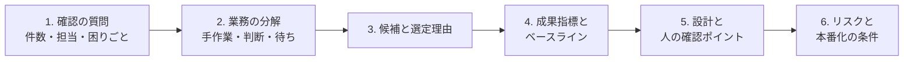

## この章のゴール

- FDE の選考で問われる 5 つのカテゴリを知り、それぞれの答えを準備する
- 実績を**状況・課題・行動・結果**の型で 2 分で語れる
- ケース面接で、質問から要件化まで順序立てて進められる
- 逆質問で、その役割が本当に FDE かを確かめられる

## 選考で見られていること

FDE は「現場に入り、業務を要件にし、作り、使われるまで責任を持つ」役割です（[FDE とは何か](/guide/what-is-fde)）。選考はこの 4 つを確かめるように設計されています。採用側の視点は [採用ガイド](/guide/hiring) にまとめています。

| カテゴリ | 典型的な質問 | 見られていること |
|---|---|---|
| 成果 | 「導入して何がどれだけ変わりましたか」 | 業務指標で語れるか、測り方を説明できるか |
| 業務理解 | 「顧客の業務をどうやって理解しましたか」 | 観察・ヒアリングの具体性 |
| AI の境界 | 「AI に任せないのはどこですか」 | 誤りのコストに基づく線引き |
| 統制 | 「機密データを AI に渡す基準は」 | データ分類・規約確認の素養 |
| 失敗 | 「一番うまくいかなかった案件は」 | 失敗の言語化と学び |

## 実績を語る型

```text
状況: {業界}の{部署}で、{業務}に月{件数}件・1 件{時間}かかっていた
課題: {何が}ボトルネックで、{誰が}困っていた
行動: 観察で{発見}→ AI に{任せたこと}、人に{残した判断}
       評価セット{件数}件で{指標}を測り、{反復回数}回改善
結果: {業務指標}が{前}→{後}（{計測方法}）。{定着の状況}
学び: {うまくいかなかったこと}と、次にどうするか
```

**数字は実測値だけを話します。** 推測を話すと、深掘りの質問で崩れます。

## ケース面接の進め方

「当社の問い合わせ対応に AI を導入するとしたら、どう進めますか」のような課題が出たら、次の順で話します。



| 段階 | 押さえる点 | 避けること |
|---|---|---|
| 確認の質問 | 件数・所要時間・担当者・困りごと・データの所在 | いきなり技術構成を話す |
| 分解と選定 | [発見](/guide/discovery)の採点軸で理由を述べる | 「全部 AI で自動化」 |
| 指標 | 業務指標・品質指標・ガードレール | 「精度 95% を目指す」だけ |
| 設計 | 誤りのコストで自動化の度合いを決める | 最初からエージェント |
| リスク | 個人情報・インジェクション・コスト上限 | リスクに触れない |

## 例示: 確認の質問リスト（ケース面接用）

> 面接練習用の例です。

1. 問い合わせは月何件で、何名で対応していますか
2. 1 件あたり、どの作業に最も時間がかかっていますか
3. 回答の根拠になる情報はどこにありますか（FAQ・過去対応・規程）
4. 誤った回答をした場合、何が起きますか
5. 個人情報はどの程度含まれますか

## 逆質問: その役割は本当に FDE か

| 質問 | 確認したいこと |
|---|---|
| 「この役割は、顧客や事業部の現場にどの程度入りますか」 | 現場への関与 |
| 「成果はどの指標で評価されますか」 | 業務指標で評価されるか |
| 「設計やリリースをどこまで自分で判断できますか」 | 裁量 |
| 「過去半年で、この役割で本番化した案件はありますか」 | 実態 |
| 「書いたコードは誰がレビューしますか」 | 品質の担保 |

## 準備のチェックリスト

- [ ] 実績を型に沿って 2 件、2 分で話せるようにした
- [ ] 5 カテゴリそれぞれの答えを準備した
- [ ] ケース面接の 6 段階を、1 つの業務で声に出して練習した
- [ ] 逆質問を 3 つ選んだ
- [ ] 応募先の業界の[領域プレイブック](/domains)を読んだ

## 関連

- [キャリアロードマップ](/guide/career-roadmap)
- [採用・発注ガイド](/guide/hiring)
