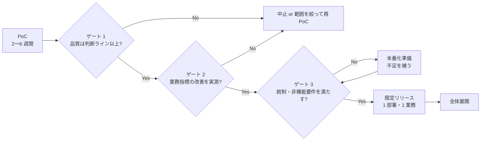
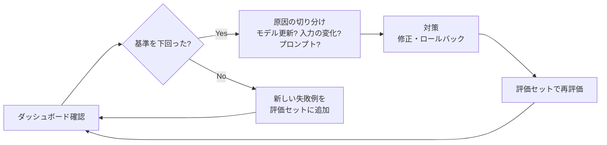

## この章のゴール

- PoC 開始時点で**本番化の判断基準・判断者・時期**を決められる
- 本番に必要な非機能要件（権限・ログ・監視・障害時の動作）を漏れなく洗い出せる
- 本番後の**週次の運用ルーティン（LLMOps）**を回せる

## 背景: PoC で止まる理由

Gartner は 2024 年 7 月、2025 年末までに生成 AI プロジェクトの少なくとも 30% が PoC 後に放棄されると予測し、理由としてデータ品質の不足、不十分なリスク管理、コストの増大、ビジネス価値の不明確さを挙げました（[出典](https://www.gartner.com/en/newsroom/press-releases/2024-07-29-gartner-predicts-30-percent-of-generative-ai-projects-will-be-abandoned-after-proof-of-concept-by-end-of-2025)）。この 4 つは、それぞれ本ガイドの[設計](/guide/solution-design)・[セキュリティ](/guide/security-governance)・[コスト](/guide/cost-and-roi)・[要件化](/guide/requirements-and-kpi)で先回りできます。

## 方法: 本番化の判断ゲート



| ゲート | 判断材料 | 判断者 |
|---|---|---|
| 1. 品質 | 評価レポート（[評価](/guide/evaluation)） | FDE + 実務担当 |
| 2. 業務効果 | ベースラインとの比較（[要件化](/guide/requirements-and-kpi)） | 業務オーナー |
| 3. 統制・非機能 | 下のチェックリスト | 情シス・統制部門 |

**PoC 開始時に、この 3 ゲートの判断者と時期を合意書に書きます。** 書いていないと、PoC 後に「誰が決めるのか」から議論が始まり、稟議が止まります。

## 本番に必要な非機能要件

| 項目 | PoC | 本番 |
|---|---|---|
| 認証・権限 | 共有アカウントでも可 | 社内認証（SSO）、文書ごとのアクセス権を検索結果に反映 |
| データ | 抜き出したサンプル | 本番データとの連携・更新頻度・削除への追随 |
| ログ | ローカル | 入力・出力・確認結果・コストを保存期間を決めて保存 |
| 監視 | なし | 品質・費用・速度・安定性のダッシュボード |
| 障害時 | 手で再実行 | タイムアウト・再試行・フォールバック（人の手順に戻す） |
| 変更管理 | 自由に変更 | プロンプトとモデルをバージョン管理し、評価通過後にリリース |
| サポート | FDE 本人 | 問い合わせ窓口と一次対応の手順 |

## LLMOps: 本番後の運用

### 従来の運用との違い

| 観点 | 従来のソフトウェア | LLM システム |
|---|---|---|
| 出力 | 決定的 | 確率的（同じ入力でも揺れる） |
| 変更 | 自分のデプロイだけ | **モデル提供元の更新でも品質が変わる** |
| テスト | パス/フェイル | スコアと閾値 |
| 障害 | 落ちる・例外 | **静かな品質劣化**（落ちないのが怖い） |

### 監視する 4 系統の指標

| 系統 | 指標例 | 劣化のサイン |
|---|---|---|
| 品質 | 採用率、修正率、引用の実在率、judge スコア | 採用率が数週連続で下落 |
| 費用 | 1 リクエストのトークン数、1 日のコスト | 同じ入力量でコストが急増 |
| 速度 | レイテンシ p50 / p95 | p95 が基準を大きく超える |
| 安定性 | エラー率、タイムアウト、レート制限 | 断続的な 429 / 5xx |

### 週次ルーティン



### モデル更新への備え

- **バージョンを固定**する（日付付きのモデル指定など、提供元が用意する固定方法を使う）
- 提供元の廃止予定を確認し、移行前に評価セットで新モデルを評価する
- 前バージョンのプロンプトとモデル指定に**いつでも戻せる**状態にしておく

## 例示: 限定リリースの計画（架空のケース）

> 手法の説明用の**架空の例**です。

| 週 | 範囲 | 確認すること |
|---|---|---|
| 1〜2 | 1 チーム 5 名 | 操作上の問題、ログが正しく取れているか |
| 3〜4 | 1 部署 | 業務指標を PoC と同じ方法で計測、問い合わせの内容 |
| 5〜 | 全社展開の稟議 | 4 週分の指標・コスト・インシデント 0 件の報告 |

## テンプレート: 本番化判断資料（1 枚）

```text
# 本番化判断資料（{業務名}）
1. 品質: 評価セット v{n} で {指標} = {値}（判断ライン {値}）
2. 業務効果: {業務指標} ベースライン {値} → PoC {値}（{件数}件で計測）
3. 統制: 個人情報の扱い {…} / ログ {…} / 権限 {…}（{承認者} 確認済）
4. コスト: 月額見込み {値}（上限設定 {…}）
5. リスクと対策: {…}
6. 展開計画: {限定リリースの範囲と期間}
7. 判断依頼: {本番化 / 追加検証 / 中止}
```

## よくある落とし穴

- **PoC で「何ができたら本番か」を決めていない**: 終了後に議論が始まり止まる
- **PoC 環境のまま本番へ**: 権限・ログ・監視がなく、事故時に説明できない
- **リリース後に評価をやめる**: 静かな品質劣化に気づけない
- **フォールバックがない**: AI が止まると業務が止まる

## チェックリスト

- [ ] PoC 開始時に 3 ゲートの判断者と時期を合意した
- [ ] 非機能要件の表をすべて埋めた
- [ ] 監視ダッシュボードと週次ルーティンを用意した
- [ ] モデルのバージョン固定とロールバック手順を用意した
- [ ] 限定リリースの範囲と期間を決めた

## 関連

- 工程: [デプロイ](/process/waterfall/deployment)・[運用・保守](/process/waterfall/maintenance)・[振り返り](/process/agile/retrospective)
- [Evaluation パターン](/patterns/evaluation)
- 次の章: [セキュリティとガバナンス](/guide/security-governance)
