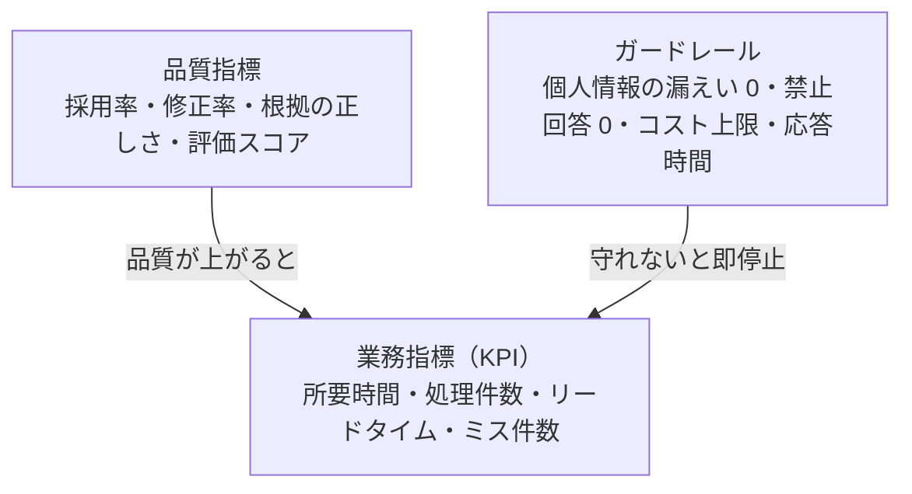

## この章のゴール

- 成功基準を**業務指標・品質指標・ガードレール**の 3 層で設計できる
- 着手前に**ベースライン**（現状値）を測り、改善を数字で語れる状態にする
- 受入基準と合意書（別紙）を作り、準委任契約でも成果の議論がぶれない状態にする

## 原則: AI の精度ではなく、業務の指標を合意する

「精度 90%」は顧客にとって意味がありません。顧客が知りたいのは「**照合作業が 1 件 40 分から何分になるか**」「**ミスが月何件減るか**」です。精度は業務指標を達成するための中間指標にすぎません。

## 方法: 指標の 3 層



| 層 | 意味 | 例 | 誰が合意するか |
|---|---|---|---|
| 業務指標 | 業務がどれだけ良くなったか | 1 件あたりの所要時間、月の処理件数、一次回答率 | 業務オーナー |
| 品質指標 | AI の出力がどれだけ使えるか | 下書きの採用率、修正箇所数、引用の正しさ | 実務担当 + FDE |
| ガードレール | 超えてはいけない線 | 個人情報の外部送信 0 件、禁止事項の回答 0 件、月額コスト上限 | 情シス・統制部門 |

## 手順: 6 ステップ

1. **業務指標を 1〜2 個に絞る**（3 個以上は追えない）
2. **ベースラインを測る**: 発見フェーズの観察を拡張し、10〜30 件の実務で所要時間・ミスを記録する
3. **目標値を置く**: 「改善幅」と「判断ライン」の 2 本（例: 目標 50% 短縮、判断ライン 30% 短縮）
4. **品質指標と評価データを決める**: どのデータで、誰が、どう採点するか（[評価](/guide/evaluation)）
5. **ガードレールを決める**: 統制部門・情シスと合意（[セキュリティとガバナンス](/guide/security-governance)）
6. **受入基準と合意書に落とす**: 下のテンプレートで別紙化

## 判断表: どの業務指標を選ぶか

| 業務の性質 | 推奨する業務指標 | 避けるべき指標 |
|---|---|---|
| 下書き・作成系（回答文、報告書） | 1 件あたりの作成時間、採用率 | 「文章の品質」（主観で揉める） |
| 検索・調査系（規程 Q&A、過去事例） | 自己解決率、問い合わせ件数、探索時間 | 回答数（多いほど良いとは限らない） |
| チェック系（契約、帳票、請求） | 見落とし件数、確認時間 | 「AI の検出率」単体（人の確認込みで測る） |
| 分類・振り分け系 | 誤振り分け率、処理リードタイム | 自動化率単体（例外の扱いが隠れる） |

## 受入基準の書き方

悪い例: 「AI が正しく回答できること」

良い例:

- [ ] 評価セット 50 件で、担当者が「そのまま、または軽微な修正で使える」と判定した割合が判断ライン以上
- [ ] 全回答に根拠（参照元の文書名・該当箇所）が表示される
- [ ] 評価セットに含まれる「答えてはいけない質問」10 件すべてで回答を控える
- [ ] 1 件あたりの API コストが合意した上限以内
- [ ] 業務担当 3 名が案内なしで操作を完了できる

**AI 製品特有の注意**: 出力の正しさだけでなく、**ユーザーが出力を検証・修正できる設計になっているか**（根拠表示・再生成・部分編集）を受入基準に入れます。

## 例示: 経理の差異コメント下書き（架空のケース）

> 手法の説明用の**架空の例**です。数値は例示です。

| 層 | 指標 | ベースライン | 目標 | 判断ライン |
|---|---|---|---|---|
| 業務 | 差異 1 件あたりのコメント作成時間 | 12 分（30 件実測） | 6 分 | 8 分 |
| 品質 | 下書きの採用率（軽微修正まで） | — | 70% | 50% |
| ガードレール | 取引先名の外部 API への送信 | — | 0 件（マスキング） | 0 件 |

## テンプレート: 成果指標合意書（別紙）

```text
# 成果指標合意書（別紙 {n}）
対象業務: {業務名}  業務オーナー: {氏名}  期間: {開始}〜{終了}
1. 業務指標: {指標名}
   - ベースライン: {値}（{計測方法}、{件数}件、{期間}）
   - 目標: {値}  判断ライン: {値}
   - 計測方法: {ログ / 抜き取り / 自己申告}、計測者: {氏名}
2. 品質指標: {指標名}  評価セット: {件数}件（{作成者}が作成）
3. ガードレール: {項目}（違反時は {停止 / 報告} する）
4. 判断: 期間終了時に {判断者} が {本番化 / 追加検証 / 中止} を決定する
5. 本合意は成果の完成を保証するものではなく、計測と判断の方法を定めるものとする
```

5 行目は準委任契約での誤解（「目標未達 = 債務不履行」）を避けるための一文です。契約上の扱いは必ず顧客の法務と確認してください。成果物の一覧は [成果物テンプレート](/references/deliverables) にあります。

## よくある落とし穴

- **ベースラインを測らずに始める**: 改善が感覚の議論になり、本番化の稟議で止まる
- **指標を盛りすぎる**: 5 個以上の指標は誰も追わない
- **自動化率を KPI にする**: 例外を人に回す設計が「失敗」に見え、危険な自動化を誘発する
- **判断ラインを決めない**: 目標未達のときに「続けるか止めるか」が政治になる

## チェックリスト

- [ ] 業務指標を 1〜2 個に絞り、業務オーナーと合意した
- [ ] 10 件以上でベースラインを計測した
- [ ] 目標値と判断ラインを分けて置いた
- [ ] ガードレールを統制部門・情シスと合意した
- [ ] 合意書（別紙）に計測方法と判断者を書いた

## 関連

- [評価](/guide/evaluation) — 品質指標の測り方
- [成果物テンプレート](/references/deliverables) — 合意書・報告書の型
- 工程: [要件定義](/process/waterfall/requirements)・[テスト](/process/waterfall/testing)
