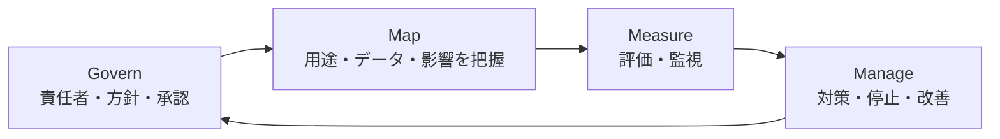

## この章のゴール

- 生成 AI に**個人データを入力するとき**に確認すべきことを、一次資料に基づいて説明できる
- LLM アプリ特有の脅威（プロンプトインジェクションなど）と対策を設計に入れられる
- 情シス・統制部門の承認を通すための**データ分類表とリスク登録簿**を作れる

## 1. 個人情報: 個人情報保護委員会の注意喚起

個人情報保護委員会は 2023 年 6 月、生成 AI サービスの利用について注意喚起を出しています。個人情報取扱事業者に対する主な注意点は次の 2 つです（[出典: 個人情報保護委員会「生成 AI サービスの利用に関する注意喚起等について」](https://www.ppc.go.jp/news/careful_information/230602_AI_utilize_alert/)）。

1. 個人情報を含むプロンプトを入力する場合、**特定された利用目的を達成するために必要な範囲内**であることを十分に確認すること
2. 本人の同意なく個人データを含むプロンプトを入力し、それが**応答結果の出力以外の目的で取り扱われる**場合、個人情報保護法に違反する可能性がある。そのため、提供事業者が**個人データを機械学習に利用しないこと等**を十分に確認すること

**FDE の実務への落とし込み**:

| 確認事項 | どこで確認するか |
|---|---|
| 入力データの利用目的が、元の取得目的の範囲内か | 顧客のプライバシーポリシー・法務 |
| 提供事業者が入力を学習に使わないか | API の利用規約・データ利用ポリシー（契約形態で異なる） |
| データの保存場所・保存期間 | サービスの仕様・リージョン設定 |
| 不要な個人情報を送らない設計か | アプリ側のマスキング（[Confidential Inputs](/patterns/confidential-inputs)） |

## 2. 国内ガイドライン: AI 事業者ガイドライン

総務省・経済産業省の「AI 事業者ガイドライン」は、AI の開発者・提供者・利用者ごとに取り組むべき事項を整理しています（[総務省のページ](https://www.soumu.go.jp/main_sosiki/kenkyu/ai_network/02ryutsu20_04000019.html)。版が更新されるため最新版を確認してください）。FDE が顧客向けにシステムを作る場合、多くは**提供者**として、顧客は**利用者**としての立場になります。どちらの立場の事項を誰が担うかを、設計時に整理しておきます。

## 3. LLM アプリ特有の脅威

OWASP は LLM アプリケーションの主要なリスクを Top 10 として公開しています（[OWASP Top 10 for LLM Applications 2025](https://genai.owasp.org/resource/owasp-top-10-for-llm-applications-2025/)）。FDE の案件で特に頻出するものと対策:

| リスク | 業務アプリでの例 | 設計上の対策 |
|---|---|---|
| プロンプトインジェクション | 読み込んだメールや文書に「以前の指示を無視して…」と書かれている | 外部入力と指示を分離、出力に対する権限を最小化、重要操作は人が確定 |
| 機微情報の漏えい | 他部署の文書が検索結果に混ざり回答に出る | 検索時に利用者の権限でフィルタ、出力のマスキング |
| 過剰な権限（Excessive Agency） | エージェントがメール送信・データ削除まで実行できる | ツール権限を最小化、書き込み系は承認制（[Human-in-the-loop](/patterns/human-in-the-loop)） |
| システムプロンプトの漏えい | 社内ルールや接続情報をプロンプトに書いている | 秘密情報をプロンプトに置かない |
| 際限のない消費 | 大量リクエストでコストが急増 | レート制限・利用上限・アラート（[コストと ROI](/guide/cost-and-roi)） |

## 4. リスク管理の枠組み: NIST AI RMF

米国 NIST の AI リスクマネジメントフレームワーク（AI RMF 1.0、2023 年 1 月公開）は、組織が AI のリスクを管理するための任意の枠組みで、生成 AI 向けのプロファイル（NIST-AI-600-1、2024 年 7 月）も公開されています（[出典: NIST](https://www.nist.gov/itl/ai-risk-management-framework)）。AI RMF は「統治（Govern）・把握（Map）・測定（Measure）・管理（Manage）」の 4 機能で構成されます。日本の顧客に対しても、リスク登録簿を作るときの観点の網羅性チェックに使えます。

## 手順: 承認を通す 5 ステップ

1. **データ分類**: 扱うデータを下の 4 区分に分ける
2. **サービス確認**: 利用する AI サービスの学習利用・保存・リージョンを確認する
3. **脅威の洗い出し**: 上の表を使い、該当するリスクと対策を書く
4. **リスク登録簿**: リスク・影響・対策・残存リスク・責任者を 1 表にまとめる
5. **承認**: 情シス・統制部門のレビューを受け、承認記録を残す

### データ分類表

| 区分 | 例 | AI への入力 |
|---|---|---|
| 公開 | 公開済みの製品情報、Web 掲載の規程 | 可 |
| 社内 | 社内規程、議事録 | 学習利用なし・契約確認済みのサービスなら可 |
| 機密 | 顧客との契約書、未公開の財務情報 | マスキング・閉域構成など追加対策の上で個別承認 |
| 規制対象 | 要配慮個人情報、医療情報、マイナンバー | 原則入力しない。必要な場合は法務と個別に設計 |

## 例示: 社内規程 Q&A のリスク登録簿（架空のケース）

> 手法の説明用の**架空の例**です。

| リスク | 影響 | 対策 | 残存リスク | 責任者 |
|---|---|---|---|---|
| 権限外の規程が回答に出る | 中 | 検索時に部署権限でフィルタ | 権限設定の誤り | 情シス |
| 誤った規程解釈を信じて手続きする | 中 | 根拠条文の表示、「最終確認は担当部署へ」の明示 | 利用者が根拠を読まない | 人事 |
| 質問に個人情報が入力される | 中 | 入力時の注意表示、ログのマスキング | 注意表示の無視 | FDE |

## よくある落とし穴

- **「社内だから大丈夫」**: 社内でも権限の違う文書が混ざると情報漏えいになる
- **利用規約を確認しない**: 同じ提供元でも契約形態で学習利用の扱いが異なる
- **エージェントに書き込み権限を広く与える**: インジェクション 1 回で被害が出る
- **承認を後回しにする**: 構築後に分類で「入力不可」となり作り直しになる

## チェックリスト

- [ ] 扱うデータを 4 区分に分類した
- [ ] 利用する AI サービスの学習利用・保存・リージョンを確認した
- [ ] 個人データの入力が利用目的の範囲内か法務と確認した
- [ ] LLM 特有の脅威と対策を設計に入れた
- [ ] リスク登録簿を作り、承認記録を残した

## 関連

- [規制マップ](/references/ai-regulation) — EU AI Act・著作権など
- [Confidential Inputs パターン](/patterns/confidential-inputs)
- 各領域の業法: [領域別プレイブック](/domains)

## 参考文献

- 個人情報保護委員会「[生成 AI サービスの利用に関する注意喚起等について](https://www.ppc.go.jp/news/careful_information/230602_AI_utilize_alert/)」（2023-06-02）
- 総務省・経済産業省「[AI 事業者ガイドライン](https://www.soumu.go.jp/main_sosiki/kenkyu/ai_network/02ryutsu20_04000019.html)」
- OWASP「[Top 10 for LLM Applications 2025](https://genai.owasp.org/resource/owasp-top-10-for-llm-applications-2025/)」
- NIST「[AI Risk Management Framework](https://www.nist.gov/itl/ai-risk-management-framework)」
