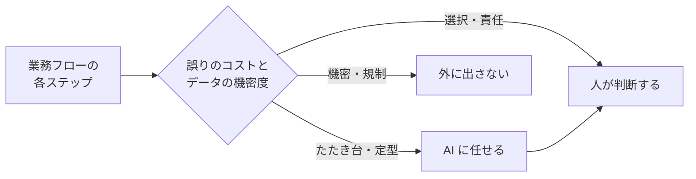
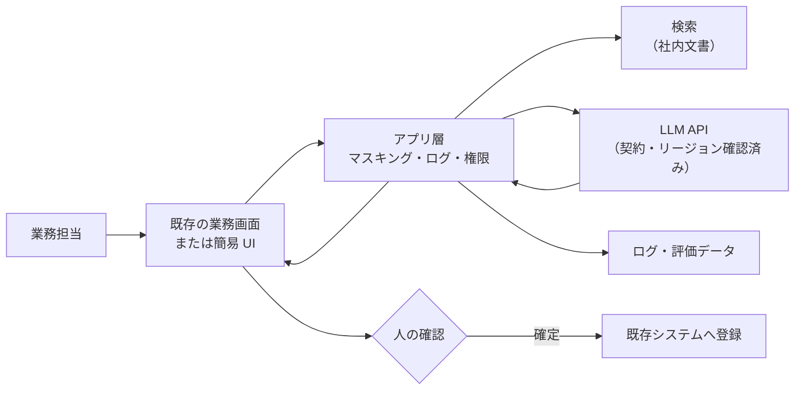

## この章のゴール

- 業務フローの各ステップを**生成 / 判断 / 禁止**の 3 分類に振り分けられる
- 課題の性質から適切な[パターン](/patterns)を判断表で選べる
- 既存システムとの連携・データの流れ・人の確認ポイントを 1 枚の構成図に描ける

## 原則: 自動化の度合いは、誤りのコストで決める

AI の出力は確率的で、必ず誤りを含みます。設計の出発点は「AI がどこまでやるか」ではなく「**誤ったときに誰が、いつ気づき、どれだけの損害になるか**」です。

| 誤りのコスト | 推奨する自動化の度合い | 例 |
|---|---|---|
| 低い（すぐ気づける・やり直せる） | AI が実行し、人は事後に抜き取り確認 | 社内文書の分類、議事録の要約 |
| 中程度 | AI が下書き、人が確認して確定 | 顧客への回答文、報告書 |
| 高い（外部影響・法的責任） | AI は根拠の提示と論点整理まで、判断は人 | 契約判断、医療・法律上の判断、採用の合否 |
| 許容できない | AI を使わない／データを渡さない | 法令で人の判断が求められる行為 |

## 手順 1: 3 分類の線引き表

業務フロー図の各ステップを次の 3 つに振り分けます。

| 分類 | 内容 | 例 |
|---|---|---|
| **AI に任せる（生成）** | たたき台・大量処理・定型 | 下書き、要約、抽出、分類、検索 |
| **人が判断する** | 選択・評価・責任 | 最終確認、例外対応、外部への送信 |
| **外に出さない（禁止）** | 機密・個人情報・規制対象 | 実名データ、認証情報、要配慮個人情報 |



## 手順 2: パターンを選ぶ

| 課題の性質 | 第一候補のパターン | 併用するパターン |
|---|---|---|
| 社内文書・規程に基づいて答える | [RAG](/patterns/rag) | [Self-check](/patterns/self-check)・[Evaluation](/patterns/evaluation) |
| 帳票・メールから項目を取り出す | [Structured Output](/patterns/structured-output) | [Human-in-the-loop](/patterns/human-in-the-loop) |
| 複数システムをまたいで手順を実行する | [Agent](/patterns/agent) | [Human-in-the-loop](/patterns/human-in-the-loop) |
| 出力の誤りが許されない | [Human-in-the-loop](/patterns/human-in-the-loop) | [Self-check](/patterns/self-check) |
| 機密データを扱う | [Confidential Inputs](/patterns/confidential-inputs) | すべて |

**迷ったら単純な方を選ぶ**。Anthropic は、エージェント構築の経験から「最も単純な解決策から始め、必要なときだけ複雑さを増やす」ことを推奨し、決まった手順で十分な場合はワークフロー（あらかじめ定義した流れ）を、柔軟な判断が必要な場合にのみエージェントを使うよう整理しています（[出典: Anthropic「Building effective agents」2024-12](https://www.anthropic.com/engineering/building-effective-agents)）。

## 手順 3: 最小構成のアーキテクチャ



設計で必ず決める 6 項目:

| 項目 | 決めること |
|---|---|
| 入口 | 既存の業務画面に組み込むか、別画面か（別画面は定着しにくい） |
| データ | どこから、どの権限で、どの頻度で取り込むか |
| モデル | どのサービス・リージョン・契約条件で使うか（[クラウド AI サービス比較](/references/cloud-ai-services)） |
| 人の確認 | どのステップで、誰が、何を見て確定するか |
| ログ | 入力・出力・確認結果をどこに、どれだけ残すか（評価と監査に使う） |
| 停止 | ガードレール違反時にどう止めるか |

## 例示: 規程 Q&A の設計（架空のケース）

> 手法の説明用の**架空の例**です。

- 分担: 規程の検索と回答の下書きは AI、回答の確定は質問者本人（社内向けのため事後確認で可）。人事評価・懲戒に関わる質問は人事担当へ回す
- パターン: RAG + Self-check（根拠が見つからない場合は「規程に記載なし」と答える）
- 入口: 社内チャットに組み込み（別サイトにしない）
- ログ: 質問・回答・参照文書・「役に立った/立たなかった」を保存し、週次で評価セットに追加

## テンプレート: 設計 1 枚紙

```text
# 解決策設計（{業務名}）
分担: AI={…} / 人={…} / 禁止={…}
パターン: {RAG / Structured Output / Agent …}（選定理由: {…}）
入口: {既存画面名 / 新規}
データ: {ソース}・{権限}・{更新頻度}・{個人情報の有無と処理}
モデル: {サービス}・{リージョン}・{学習利用なしの確認}
人の確認: {ステップ}・{担当}・{確認観点}
ログ: {項目}・{保存先}・{保存期間}
停止条件: {ガードレール違反時の動作}
```

## よくある落とし穴

- **最初からエージェントにする**: 手順が決まっている業務はワークフローで十分。デバッグと評価が難しくなる
- **別画面を作る**: 業務担当が画面を行き来する手間で使われなくなる
- **人の確認を「全部見る」にする**: 確認が形骸化する。確認すべき観点を絞り、画面に示す
- **ログを残さない**: 評価・改善・監査のすべてで困る

## チェックリスト

- [ ] 業務フローの全ステップを 3 分類に振り分けた
- [ ] 誤りのコストから自動化の度合いを決めた
- [ ] パターンを判断表で選び、理由を書いた
- [ ] 設計 1 枚紙の 6 項目を埋めた
- [ ] 情シス・統制部門に設計をレビューしてもらった

## 関連

- [パターン一覧](/patterns)
- 工程: [設計](/process/waterfall/design)
- 次の章: [構築ループ](/guide/build-loop)

## 参考文献

- Anthropic「[Building effective agents](https://www.anthropic.com/engineering/building-effective-agents)」（2024-12-19）
