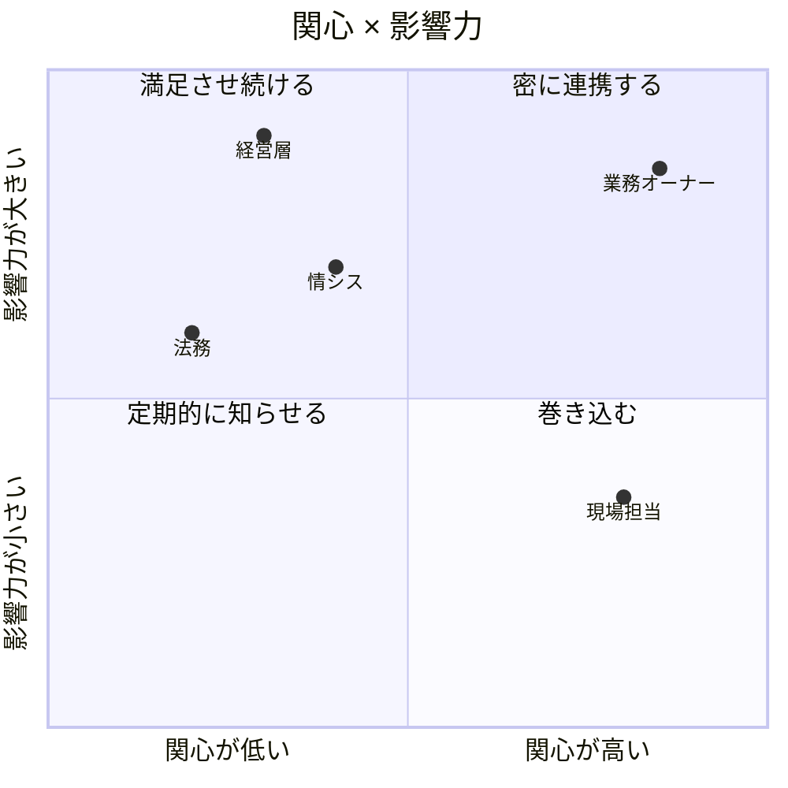
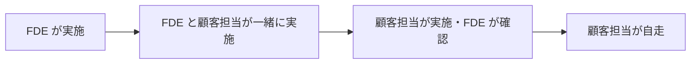

## この章のゴール

- 関係者の**関心と影響力**を地図にし、誰に何をいつ伝えるかを決められる
- 現場の抵抗の理由を見極め、理由に応じた手を打てる
- FDE が抜けても回る状態（**運用移管**）まで持っていける

## なぜ定着が最難関か

IPA「DX 動向 2025」によると、生成 AI が部署の業務プロセスに組み込まれている日本企業は 1 割程度で、多くは個人利用や試験利用にとどまっています（[出典: IPA 説明会資料](https://www.ipa.go.jp/event/2025/tbl5kb0000001rzs-att/dx-trend-2025-Webinar-Handouts.pdf)）。ツールが使える状態と、業務がそれを前提に回っている状態の間には大きな差があり、その差を埋めるのは技術ではなく人と段取りです。

## 手順 1: ステークホルダーマップ



| 関係者 | 主な関心 | FDE が出すもの | 頻度 |
|---|---|---|---|
| 業務オーナー | 業務指標が動くか、部下の負担 | 反復レポート・指標の推移 | 週次 |
| 現場担当 | 仕事が楽になるか、評価がどうなるか | 試用への同席・改善の反映 | 反復ごと |
| 情シス | セキュリティ・運用負荷 | 設計 1 枚紙・リスク登録簿 | 設計時・本番化前 |
| 経営層 | 投資対効果・リスク | 本番化判断資料（1 枚） | ゲートごと |
| 法務・統制 | 法令・契約違反がないか | データ分類表・利用規約の確認結果 | 着手時・変更時 |

## 手順 2: 抵抗の理由を見極める

| 抵抗の表れ | よくある理由 | 打ち手 |
|---|---|---|
| 「AI の答えは信用できない」 | 根拠が見えない／一度の誤りの印象 | 根拠表示、誤りのケースを評価セットで公開し改善を示す |
| 使ってくれない | 既存業務の手順に組み込まれていない | 業務画面への組み込み、手順書の改訂 |
| 「仕事を奪われる」 | 評価・雇用への不安 | 創出された時間の使い道を業務オーナーと先に決めて伝える |
| 情シスが承認しない | リスクが説明されていない | データ分類・リスク登録簿・停止手順を先に出す |
| 熱心な 1 人だけが使う | 属人化 | 推進役を部署ごとに 1 人置き、使い方の共有会を開く |

## 手順 3: 運用移管

FDE が抜けたあとも回るように、[成果物テンプレート](/references/deliverables) の「運用移管書」を作り、次の 4 点を顧客側の担当者に渡します。

1. **プロンプト・参照文書の更新手順**と承認者
2. **評価セットと評価の回し方**（[評価](/guide/evaluation)）
3. **監視と週次ルーティン**（[本番化](/guide/poc-to-production)）
4. **問い合わせ窓口と停止手順**



## 例示: 週次定例のアジェンダ（架空のケース）

> 手法の説明用の**架空の例**です。

```text
週次定例（30 分）
1. 指標（5 分）: 業務指標・品質指標の推移、ガードレール違反
2. 今週の試用で分かったこと（10 分）: 代表的な事例を 2〜3 件
3. 次の反復（5 分）: 何を直すか
4. 判断が必要なこと（10 分）: 業務オーナーに決めてもらう項目
```

## FDE 自身の立ち位置を守る

採用・配属時、または案件の開始時に確認しておくこと:

- 判断できる範囲（設計・リリース・スコープ）はどこまでか
- 書いたコードは誰がレビューし、どのリポジトリに入るか
- 業務オーナーと直接話せるか（間に何層あるか）
- スコープ外の依頼を断る基準（スコープ外リスト）があるか

## よくある落とし穴

- **業務オーナーではなく窓口担当とだけ話す**: 判断が必要なときに決まらない
- **成果を FDE が発表する**: 現場の担当者に発表してもらうと定着が進む
- **移管を最後の 1 週間でやる**: 段階的に移す
- **雑多な依頼を全部拾う**: 本来の成果指標が進まない

## チェックリスト

- [ ] ステークホルダーマップを作り、伝える内容と頻度を決めた
- [ ] 抵抗の理由を特定し、打ち手を実行した
- [ ] 部署ごとの推進役を決めた
- [ ] 運用移管書を作り、段階的に移管した
- [ ] スコープ外リストを合意した

## 関連

- 工程: [振り返り](/process/agile/retrospective)・[運用・保守](/process/waterfall/maintenance)
- [公開事例集](/references/case-studies)
