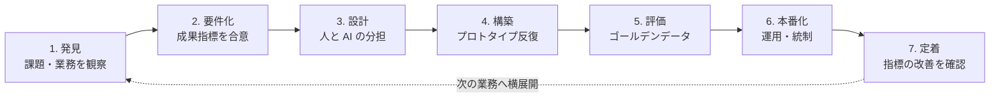

## この章のゴール

- FDE（Forward Deployed Engineer）を**一文で説明**でき、似た職種との違いを判断表で説明できる
- FDE の成果物が「動くシステム」ではなく「**動いた業務指標**」であることを理解する
- 自分（または採用したい人）がどこから学べばよいか、学習パスのどこから読むかを決められる

## 一文で言うと

> FDE は、**顧客・事業部の現場に入り込み、課題の発見から要件化・実装・本番導入・定着までを一人称で担い、業務指標が動くまで責任を持つエンジニア**である。

「前線に配備された（forward deployed）」という言葉どおり、本社で汎用機能を作るのではなく、**特定の顧客の現場で、その顧客の問題を解く**ことに最適化された役割です。

## 起源: Palantir の「Delta」

この職種名を広めたのは Palantir です。同社のエンジニアリングブログは、Forward Deployed Software Engineer（社内呼称「Delta」）を次のように説明しています（[出典: Palantir Blog「A Day in the Life of a Palantir Forward Deployed Software Engineer」2020-11](https://blog.palantir.com/a-day-in-the-life-of-a-palantir-forward-deployed-software-engineer-45ef2de257b1)）。

- 顧客に**直接入り込み（embeds directly with our customers）**、既存のプラットフォームを構成して顧客の最も難しい問題を解く
- 通常のソフトウェアエンジニア（「Dev」）が「**多くの顧客に使われる 1 つの機能**」を作るのに対し、FDSE は「**1 つの顧客のために多くの機能を使えるようにする**」
- コンサルタントとの違いは、既製のプラットフォームを組み合わせて**速く、技術的に**解決を届けられる点

## なぜ今、生成 AI で FDE が求められるのか

### 1. AI は「入れただけ」では業務が変わらない

a16z は 2025 年 6 月の記事で、営業・サポート・法務などの複雑な業務に AI エージェントを定着させるには、**顧客ごとの実装支援（implementation services）が不可欠**で、その担い手として FDE が AI スタートアップで最も求められる職種になっていると論じています。エージェントには人間の新入社員と同じく、社内システムへのアクセス・文脈・継続的な指導が必要だから、という理由です（[出典: a16z「Trading Margin for Moat: Why the Forward Deployed Engineer Is the Hottest Job in Startups」2025-06-04](https://a16z.com/services-led-growth/)）。

### 2. PoC で止まるプロジェクトが多い

Gartner は 2024 年 7 月、「2025 年末までに生成 AI プロジェクトの**少なくとも 30% が PoC 後に放棄される**」と予測し、原因としてデータ品質の不足、リスク管理の不備、コストの増大、ビジネス価値の不明確さを挙げました（[出典: Gartner プレスリリース 2024-07-29](https://www.gartner.com/en/newsroom/press-releases/2024-07-29-gartner-predicts-30-percent-of-generative-ai-projects-will-be-abandoned-after-proof-of-concept-by-end-of-2025)）。このどれもが、**技術だけでなく業務・データ・統制を横断して扱う人**がいないと解けない問題です。

### 3. 日本では「現場知見 × AI」の人材が足りない

IPA「DX 動向 2025」は、日本企業で不足が顕著な AI 関連人材の上位として「データマネジメント知見 × 社内推進」「**現場知見 × AI の基礎知識**」「AI ツール活用 × 業務活用」を挙げ、いずれも 7 割を超える企業で不足していると報告しています。同資料はさらに、生成 AI が部署の業務プロセスに組み込まれている割合が米独の 4 割弱に対し日本は 1 割程度であること、日本企業の生成 AI 導入課題として「効果やリスクに関する理解不足」「ハルシネーション（誤回答）への懸念」が高いことも示しています（[出典: IPA「DX 動向 2025」説明会資料](https://www.ipa.go.jp/event/2025/tbl5kb0000001rzs-att/dx-trend-2025-Webinar-Handouts.pdf)、[本文](https://www.ipa.go.jp/digital/chousa/dx-trend/tbl5kb0000001mn2-att/dx-trend-2025.pdf)）。

FDE はまさにこの「現場知見 × AI」を一人で、または小さなチームで埋める役割です。

## FDE の仕事: 7 つのフェーズ

各フェーズは学習パスの章に 1 対 1 で対応しています（[発見](/guide/discovery) → [要件化](/guide/requirements-and-kpi) → [設計](/guide/solution-design) → [構築](/guide/build-loop) → [評価](/guide/evaluation) → [本番化](/guide/poc-to-production) → [定着](/guide/stakeholders)）。

## 似た職種との違い（判断表）

| 観点 | FDE | IT コンサルタント | SE（受託開発） | AI / ML エンジニア | ソリューションアーキテクト（ベンダー） |
|---|---|---|---|---|---|
| 主な成果物 | **業務指標の改善**と、それを支える動くシステム | 提言・計画書 | 仕様どおりのシステム | モデル・精度 | 提案・構成図 |
| 現場への関与 | 常駐・同席して観察 | ヒアリング中心 | 要件確定後は限定的 | 限定的 | プリセールス中心 |
| 自分でコードを書くか | 書く（AI ツールで増幅） | 原則書かない | 書く | 書く | デモ程度 |
| 責任の終点 | 現場で使われ、指標が動くまで | 提言の受け入れ | 検収 | モデル性能 | 受注 |
| 要件が曖昧なとき | 自分で観察して要件化 | 整理して提示 | 確認を求める | データ・タスク定義を求める | 製品機能に寄せる |

**判定のコツ**: 「要件が曖昧な状態から、自分で業務を観察して要件にし、動くものを作り、使われるまで面倒を見るか」。この 4 つが揃えば FDE の仕事です。

## FDE の一週間（例示シナリオ）

> 以下は役割をイメージするための**架空の例**です。特定の企業・案件を表すものではありません。

| 曜日 | やっていること |
|---|---|
| 月 | 顧客の経理部で月次締めの作業に同席。担当者 3 名の手順を観察し、差異確認に時間がかかっている箇所をメモ |
| 火 | 観察結果を業務フロー図に起こし、「差異コメントの下書き」を AI の担当候補として部長と合意。成果指標（1 件あたりの所要時間）と測り方を決める |
| 水 | 過去 3 か月分の差異データで、構造化出力 + 根拠付きの下書きプロトタイプを作成 |
| 木 | 担当者と一緒に 20 件を試し、修正された箇所をゴールデンデータに追加。プロンプトと入力項目を修正 |
| 金 | 情報システム部門とデータ連携・ログ保存・権限を確認。来週の評価計画をまとめて共有 |

## 必要なスキルの全体像

| 領域 | 中身 | 学ぶ章 |
|---|---|---|
| 業務理解 | 観察・ヒアリング・業務フロー化・成果指標の設計 | [発見](/guide/discovery)・[要件化](/guide/requirements-and-kpi) |
| AI 実装 | RAG・構造化出力・エージェント・評価 | [パターン](/patterns)・[構築](/guide/build-loop)・[評価](/guide/evaluation) |
| システム連携 | API・データ・権限・既存システムとの接続 | [設計](/guide/solution-design)・[本番化](/guide/poc-to-production) |
| 統制 | セキュリティ・個人情報・法令・監査 | [セキュリティとガバナンス](/guide/security-governance) |
| 推進 | ステークホルダー・変化への抵抗・費用対効果の説明 | [ステークホルダー](/guide/stakeholders)・[コストと ROI](/guide/cost-and-roi) |

## よくある誤解

- **「FDE = 客先常駐のエンジニア」**: 常駐は手段にすぎません。仕様を受け取って作るだけなら FDE ではありません
- **「AI に詳しければ FDE になれる」**: 現場で最も難しいのは「何を AI に任せ、何を人に残すか」を業務側と合意することです
- **「PoC が成功したら終わり」**: FDE の仕事の後半（本番化・定着）こそが、PoC 止まりのプロジェクトとの差です

## このナレッジベースの読み方

| あなたは | まず読む | 次に |
|---|---|---|
| FDE を目指すエンジニア | この章 → [発見](/guide/discovery) → [要件化](/guide/requirements-and-kpi) | [パターン](/patterns)・[キャリア](/guide/career-roadmap) |
| 業務側から AI 推進を任された人 | この章 → [要件化](/guide/requirements-and-kpi) → [ステークホルダー](/guide/stakeholders) | [領域別プレイブック](/domains) |
| FDE を採用・発注する企業 | この章 → [採用・発注ガイド](/guide/hiring) | [市場データ](/market)・[コストと ROI](/guide/cost-and-roi) |

## チェックリスト

- [ ] FDE を一文で説明できる
- [ ] コンサル・SE・AI エンジニアとの違いを判断表で説明できる
- [ ] 7 フェーズのうち、自分が最も弱いフェーズを特定した

## 参考文献

- Palantir Blog「[A Day in the Life of a Palantir Forward Deployed Software Engineer](https://blog.palantir.com/a-day-in-the-life-of-a-palantir-forward-deployed-software-engineer-45ef2de257b1)」（2020-11-02）
- a16z「[Trading Margin for Moat](https://a16z.com/services-led-growth/)」（2025-06-04）
- Gartner「[30% of Generative AI Projects Will Be Abandoned After Proof of Concept By End of 2025](https://www.gartner.com/en/newsroom/press-releases/2024-07-29-gartner-predicts-30-percent-of-generative-ai-projects-will-be-abandoned-after-proof-of-concept-by-end-of-2025)」（2024-07-29）
- IPA「[DX 動向 2025](https://www.ipa.go.jp/pressrelease/2025/press20250626.html)」（2025-06-26）
