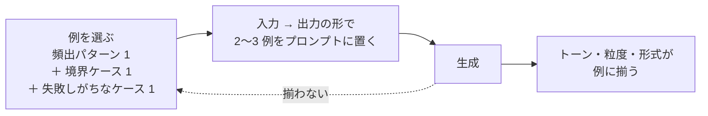

## 概要

「こういう風に出力して」と説明する代わりに、**入力→出力の良い例を 2〜3 個見せる**パターン。説明では伝わらない細かいトーン・粒度・省略の加減まで合わせられる、最も費用対効果の高い手法です。

## 仕組み

```text
次の例と同じ形式・トーンで出力してください。

例1:
入力: 「昨日から〇号機の音がおかしい」
出力: {設備: 〇号機, 現象: 異音, 発生時期: 昨日以降}

例2:
入力: 「3番倉庫、在庫の数合わないかも」
出力: {設備: 3番倉庫, 現象: 在庫数不一致, 発生時期: 不明}

対象の入力: （ここに実際の入力）
```



## 適している場面

- 出力の**トーン・粒度を揃えたい**定型タスク（報告書、分類、要約）
- 構造化出力の形式を確実に守らせたい（[構造化出力](./structured-output.md)と併用）
- 長い説明より「例で見せたほうが早い」場面。ほとんどの場面がこれ

## 各領域での応用

- 教育: 過去の良いフィードバック文を例として渡す → 採点コメントのトーンが揃う（[採点支援](../domains/education/use-cases/grading-assistant.md)）
- 営業: 自分の過去の提案書を 1 部渡す → 社内の文体で出てくる
- 法務: 過去の整理結果を例に → 条項抽出の粒度が安定する

## 落とし穴

- 例が 1 個だとその例の癖を過剰に真似る（例1 の「異音」しか出さない等）。**2〜3 個、バリエーションを変えて**渡す
- 例に機密情報をそのまま使わない。仮名化・架空化した例を用意する
- 例が古いと出力も古くなる: プロンプトの型（[構築ループ](/guide/build-loop)）を更新するときは例も一緒に見直す

## 例の選び方とコスト

- 選定基準: **頻出パターン 1 + 境界ケース 1 + 失敗しがちなケース 1**。全員「きれいな例」だけだと、きれいな入力にしか強くならない
- 例のトークンコスト目安: 1 例 100〜200 トークン。3 例なら毎リクエスト +300〜600 トークン——**月 1 万リクエストなら数ドル〜十数ドル**のコスト増（[コスト見積もり](/guide/cost-and-roi)に含める）
- 例の更新: トーンや形式を変えたら例も更新する。例の変更履歴をプロンプトファイルのメモに残す（[構築ループ](/guide/build-loop)）

## 使うか・使わないか（判断表）

| 状況 | 判断 | 代わりの選択肢 |
|---|---|---|
| 出力の文体・形式を社内の型に合わせたい | 使う | — |
| 分類の境界が言葉で説明しにくい | 使う（境界例を入れる） | — |
| 例の中に機密情報が含まれる | マスキングしてから使う | [Confidential Inputs](/patterns/confidential-inputs) |
| 例が多すぎてコストが高い | 例を減らすか検索で選ぶ | [RAG](/patterns/rag) で類似例を取得 |

## 導入の手順

1. 業務担当に「模範」と「よくある誤り」の実例を 5〜10 件出してもらう
2. 典型例と境界例を混ぜて 3〜5 件選ぶ
3. 例の順序・偏りが出力に影響するため、評価セットで複数の組み合わせを比較する
4. 例をプロンプト資産として Git 管理し、変更時は再評価する

## 例示: 問い合わせメールの分類（架空のケース）

> 手法の説明用の**架空の例**です。特定の企業の事例ではありません。

「返品」「配送」「請求」「その他」の 4 分類で、境界があいまいな「届いた商品が違うので返金してほしい」を返品の例として明示。境界例を入れたことで返品と請求の取り違えが減った

## 導入チェックリスト

- [ ] 例は実データから選び、典型例と境界例を両方含む
- [ ] 例の個人情報・機密を匿名化した
- [ ] 例の数を増やした時の精度とコストを比較した
- [ ] 例の更新者・更新日を管理している

## 関連リスク（出典）

- 例に実データを使う場合も個人情報の扱いに注意する（出典: [個人情報保護委員会「生成AIサービスの利用に関する注意喚起等」](https://www.ppc.go.jp/news/careful_information/230602_AI_utilize_alert/)）

## 参考文献

- [Brown et al.「Language Models are Few-Shot Learners」（2020）](https://arxiv.org/abs/2005.14165)
