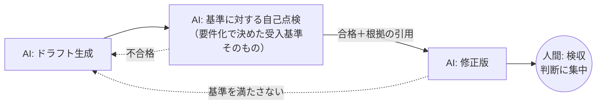

## 概要

AI の出力をすぐ人間に渡すのではなく、**受け入れ基準を渡して AI 自身に点検・修正させる**パターン。「たたき台 → 自己点検 → 修正済み成果物 → 人間の検収」という順にすることで、人間のレビューは「細かい指摘」から「判断」に変わります。

## 仕組み



プロンプトの型:

```text
上記の出力を、次の受け入れ基準で自己点検してください。
基準: （要件化で決めたチェックリストをそのまま貼る）
・各基準について 合格/不合格 と、根拠（本文の該当箇所）を出す
・不合格があれば修正版を出す
```

## 適している場面

- 受け入れ基準を明文化できているタスク（[要件化と成果指標](/guide/requirements-and-kpi) を終えていることが前提）
- 手戻りコストが高い成果物（提出物・対外文書）
- レビュー工数が足りないチーム

## 各領域での応用

- 教育: 採点下書きがルーブリック全項目を満たすか自己点検（[採点支援](../domains/education/use-cases/grading-assistant.md)）
- 法務: 条項抽出に抜けがないか、自己点検で項目数を再確認
- 製造: 手順書ドラフトの `[要確認]` 残存を自己申告させる

## 落とし穴

- **自己点検は自己肯定に寄る**: 「合格」と言わせただけでは意味がない。根拠（該当箇所の引用）を必須にし、引用できない基準は不合格扱いにする
- 基準が曖昧だと自己点検も曖昧。まず受け入れ基準を書く（[評価パターン](./evaluation.md)と併用）
- 2 周目以降は効果が薄れる。1〜2 周で止め、人間の検収につなぐ

## 使うか・使わないか（判断表）

| 状況 | 判断 | 代わりの選択肢 |
|---|---|---|
| 受入基準をチェックリストで書ける | 使う | — |
| 誤りが事実の誤り（根拠の有無） | 使う（入力文書との突合） | — |
| 判断に専門的な正解が必要 | 単独では不十分 | [Human-in-the-loop](/patterns/human-in-the-loop) |
| コスト・速度が厳しい | ルールチェックで代替 | [Evaluation](/patterns/evaluation) のルール部分 |

## 導入の手順

1. 受入基準をチェックリストにする（[要件化と成果指標](/guide/requirements-and-kpi)）
2. 生成とは別の呼び出しで、チェックリストに対する点検を行わせる
3. 点検結果を構造化出力で受け取り、不合格項目だけ修正させる
4. 修正は 1〜2 回まで。それでも不合格なら人へ回す
5. 点検の見逃し率を、人手評価との比較で測る

## 例示: 顧客向けお知らせ文の点検（架空のケース）

> 手法の説明用の**架空の例**です。特定の企業の事例ではありません。

生成した配送遅延のお知らせ文を、「日付と対象地域が入力と一致」「謝罪と代替案がある」「社外秘情報がない」の 3 項目で点検。評価では点検が日付の不一致を見逃すことがあり、日付だけはコードで入力と突合する形に置き換えた

## 導入チェックリスト

- [ ] チェック観点を業務の受入基準から作った
- [ ] 自己チェックで直せない誤り（事実誤認）は別の検証（参照データ照合）で拾う
- [ ] チェック前後の差分を記録し、効果を測っている

## 参考文献

- [Madaan et al.「Self-Refine: Iterative Refinement with Self-Feedback」（2023）](https://arxiv.org/abs/2303.17651)
- [Anthropic「Building effective agents」（Evaluator-optimizer の節）](https://www.anthropic.com/engineering/building-effective-agents)
