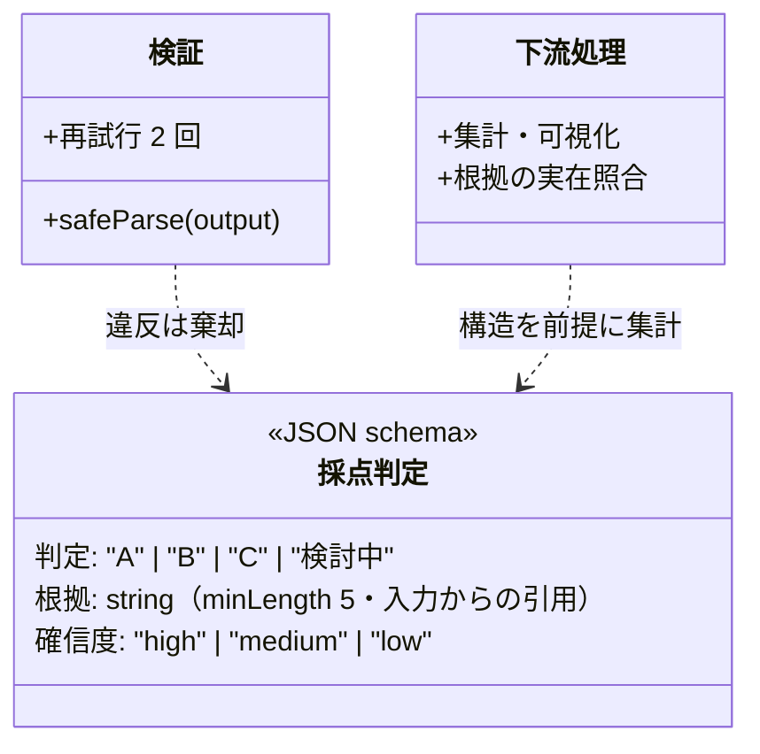

## 概要

AI に文章で答えさせる代わりに、**あらかじめ決めた形式（JSON・表・固定項目）で出力させる**パターン。出力を機械処理・検証・集計できるようになり、協働の「検収」を自動化できる。

## 仕組み

```text
「次の JSON 形式でのみ回答してください。
 項目: 判定(A/B/C), 根拠(引用), 確信度(high/medium/low)
 禁止: JSON 以外のテキスト」
```

→ 出力をスキーマで検証 → 不合格なら再生成 or 人間へ

出力の「型」を UML のクラス図として先に決めておくと、プロンプト・スキーマ検証・下流の集計の 3 つが同じ定義を共有できる:



## 適している場面

- 分類・判定・抽出系のタスク（採点判定、アンケート分類、条項抽出）
- 出力を集計・可視化したい場面（傾向分析）
- AI 出力をシステムに取り込む自動化パイプライン

## 各領域での応用

- 教育: 答案を設問ごとに {達成度, 引用, フィードバック} で出力
- 製造: 不具合報告を {現象, 発生工程, 重要度候補} に分解
- 法務: 契約条項を {条項番号, 分類, 雛形との差分} で一覧化

## 落とし穴

- 形式違反（JSON の外に文章が出る、項目の欠落）→ スキーマ検証 + 再試行を必ず入れる
- **構造は正しいが中身が間違い**の見逃し: 構造化は検証を楽にするだけで、正しさは保証しない。根拠（引用）項目を持たせて突き合わせる
- 項目設計が悪いと集計できない: 先に「集計して何を知りたいか」を決めてから項目を設計する

## 実装の型（スキーマ → 検証 → 再試行）

### 1. JSON Schema の例

```json
{
  "type": "object",
  "required": ["判定", "根拠", "確信度"],
  "properties": {
    "判定": { "type": "string", "enum": ["A", "B", "C", "検討中"] },
    "根拠": { "type": "string", "minLength": 5 },
    "確信度": { "type": "string", "enum": ["high", "medium", "low"] }
  },
  "additionalProperties": false
}
```

### 2. API 側の指定（例: Anthropic / OpenAI）

```text
・Anthropic: messages API でツール（input_schema）として上記スキーマを渡す
・OpenAI: response_format: { type: "json_schema", strict: true }
```

### 3. 検証と再試行（TypeScript + Zod）

```ts
const parsed = schema.safeParse(JSON.parse(output));
if (!parsed.success) {
  if (retryCount < 2) return generateAgain(`${output}\n\n上記は次のエラーで不正: ${parsed.error.message}。スキーマどおりに修正`);
  notifyHuman(output); // 2 回失敗したら人間へ
}
```

**構造の合格 ≠ 中身の正しい**: 根拠（引用）の突合は別途 [評価](./evaluation.md) で行う。

## 合格例 / 不合格例

✅ **合格例**（スキーマどおり・根拠が入力に実在）:

```json
{ "判定": "B", "根拠": "答案 3 行目「y = (x - 2)² - 3」— 定数移動の符号誤り", "確信度": "high" }
```

❌ **不合格例 1**（スキーマ違反）: `{ "score": 6, "reason": "だいたい良い" }` — 必須項目の欠落・enum 外・項目名の勝手な変更

❌ **不合格例 2**（構造は正しいが根拠が不在）: `{ "判定": "B", "根拠": "概ね正しい記述", "確信度": "high" }` — 根拠の実在照合で棄却する（[評価](./evaluation.md)）

## 使うか・使わないか（判断表）

| 状況 | 判断 | 代わりの選択肢 |
|---|---|---|
| 後続のシステムに登録・連携する | 使う | — |
| 帳票・メールから決まった項目を抜く | 使う | — |
| 自由な文章が成果物 | 使わない（形式だけ指定すれば十分） | [Few-shot](/patterns/few-shot) |
| 項目が毎回変わる | スキーマを緩くするか分割 | [Prompt Chaining](/patterns/prompt-chaining) |

## 導入の手順

1. 業務システムの登録画面・CSV から、必要な項目と型・必須/任意を洗い出す
2. JSON Schema（または各社の構造化出力・ツール定義の機能）で出力形式を定義する
3. 「入力にない値は null」「推測しない」を制約に入れる
4. アプリ側でスキーマ検証し、失敗時は 1〜2 回だけ再試行、それでも失敗なら人へ回す
5. 項目ごとの一致率を評価セットで測り、誤りの多い項目から直す

## 例示: 請求書 PDF から会計システムへの登録（架空のケース）

> 手法の説明用の**架空の例**です。特定の企業の事例ではありません。

請求書から取引先名・請求日・金額・税率・支払期日を JSON で抽出し、スキーマ検証後に会計システムの仕訳候補として表示。担当者が確認して確定する。評価では「支払期日が本文中の別の日付と混同される」誤りが多く、項目の説明文に「『お支払期限』の記載のみを使う」と追記して改善した

## 導入チェックリスト

- [ ] スキーマを JSON Schema / Zod などコードで定義した
- [ ] 検証失敗時の再試行回数と最終的な人手対応を決めた
- [ ] 下流システムの項目定義とスキーマの対応表がある
- [ ] スキーマ変更時に互換性テストがある

## 関連リスク（出典）

- 出力をそのまま下流システムに渡すと不適切な出力処理（Improper Output Handling）のリスクになる（出典: [OWASP Top 10 for LLM Applications](https://genai.owasp.org/llm-top-10/)）

## 参考文献

- [OpenAI「Structured Outputs」ドキュメント](https://platform.openai.com/docs/guides/structured-outputs)
- [Anthropic「Tool use with Claude」ドキュメント](https://docs.anthropic.com/en/docs/build-with-claude/tool-use)
